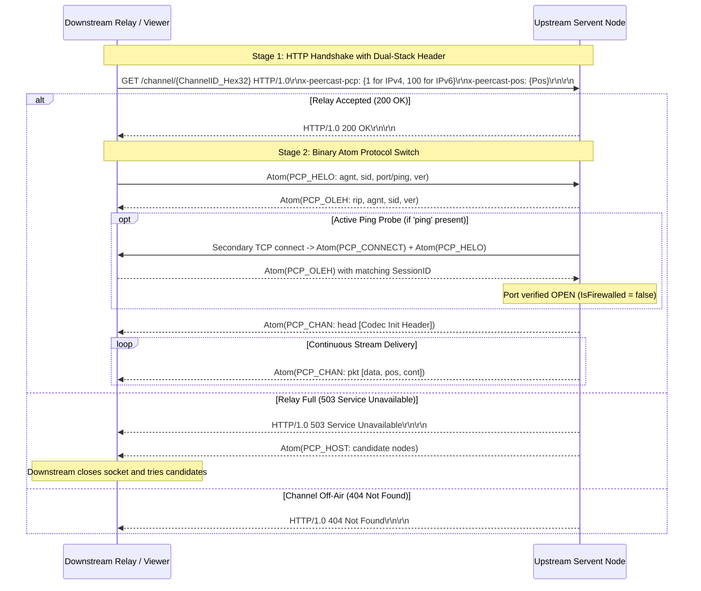

# PeerCastStation Rust Port: Architectural Specification & Implementation Blueprint

> **Document Version**: 1.3.0 (Cross-Audited with `kumaryu/peercaststation` & `plonk/peercast-yt`)  
> **Status**: APPROVED / ACTIVE SPECIFICATION & IMPLEMENTATION MASTER PLAN  
> **Target Upstream References**:  
>   1. [kumaryu/peercaststation (C# / .NET)](https://github.com/kumaryu/peercaststation)  
>   2. [plonk/peercast-yt (C++ Native YT50)](https://github.com/plonk/peercast-yt)  
> **Author**: Antigravity Engineering Agent  
> **Target Ecosystem**: Rust 2021/2024 Edition, Tokio Multi-Threaded Async Runtime  

---

## 1. Executive Summary & Core Mission

### 1.1 Objective
This document provides the definitive architectural specification and actionable implementation blueprint for developing **PeerCastStation_Rust**, a complete, memory-safe, cross-platform Rust port of the standard PeerCast servent.

To ensure 100% interoperability across the entire PeerCast ecosystem, this specification has been cross-audited against both the modern C# implementation (**PeerCastStation**) and the definitive C++ native implementation (**peercast-yt**).

### 1.2 Non-Negotiable Engineering Principles
1. **100% Dual-Implementation Interoperability**: Seamlessly interoperate with both C# nodes (PeerCastStation) and C++ nodes (PeerCast-YT / PeerCast-IM), Yellow Pages, and standard media players (VLC, mpv, MPC-HC, WMP).
2. **Authentic Two-Stage Handshake**: Replicate the exact PeerCast connection sequence: HTTP-based handshake (`GET /channel/...`) followed by immediate protocol upgrade to binary Atoms.
3. **Deterministic ChannelID Derivation**: Reproduce the cryptographic algorithm (`SHA512(BCID) + Network + Metadata -> MD5`) to ensure identical Channel IDs across the network.
4. **Keyframe-Aligned Player Startup**: Suppress non-keyframe packets until the first I-frame arrives to eliminate video corruption and decoding freezes for newly connecting players.
5. **Zero-Copy Fan-Out**: Distribute streaming packets using atomic reference-counted slices (`bytes::Bytes`) to ensure $O(1)$ packet dispatch without heap reallocation.
6. **Deterministic Resource Bounds (Rule #3)**: Strictly cap all buffers (8 MB / 3-second sliding ring buffer), packet payloads (`MAX_DATALEN = 16384`), packet queues (5-second drop guard), and node caches (180-second TTL) to guarantee indefinite 24/7/365 uptime.
7. **Strict State Machine Modeling (Rule #2)**: Eliminate combinatorial booleans in favor of explicit Rust `enum` state machines with re-entrancy protection.
8. **Single Self-Contained Native Executable**: Headless daemon, embedded Web UI assets (`rust-embed`), and JSON-RPC 2.0 API compiled into one static binary.

---

## 2. Upstream Architecture & Cross-Reference Mapping

| Upstream Subsystem | C# Reference (`peercaststation`) | C++ Reference (`peercast-yt`) | Target Rust Crate |
| :--- | :--- | :--- | :--- |
| **Primitives, Atoms & Buffers** | `Atom.cs`, `Ringbuffer.cs`, `Content.cs` | `atom.h`, `cstream.cpp`, `chanpacket.h` | `crates/peercast-core` |
| **PCP Handshake & Protocols** | `PCPSourceStream.cs`, `PCPOutputStream.cs` | `pcp.cpp`, `servhs.cpp`, `servmgr.cpp` | `crates/peercast-pcp` |
| **Media Containers & Sniffers** | `FLVContentBuffer.cs`, `TSContentReader.cs` | `flv.cpp`, `mkv.cpp`, `ogg.cpp`, `mms.cpp` | `crates/peercast-format` |
| **HTTP Player & Ingest** | `HTTPOutputStream.cs`, `PlayList.cs` | `servhs.cpp`, `http.cpp`, `playlist.cpp` | `crates/peercast-http` |
| **Yellow Page Integration** | `PCPYellowPageClient.cs`, `YPChannelsHost.cs`| `chandir.cpp`, `yplist.cpp`, `uptest.cpp` | `crates/peercast-yp` |
| **Servent & Channel Manager** | `PeerCast.cs`, `Channel.cs`, `HostTree.cs` | `channel.cpp`, `chanmgr.cpp`, `chanhit.cpp` | `crates/peercast-servent` |
| **RPC & Web Interface** | `APIHost.cs`, `JSONRPC.cs`, `html/` assets | `jrpc.cpp`, `cgi.cpp`, `html.cpp` | `crates/peercast-rpc` + `crates/peercast-web` |
| **Daemon Entry Point** | `PecaStationd` | `peercast.cpp`, `main.cpp` | `crates/peercast-app` |

---

## 3. Deep-Dive Wire Protocol Specifications

### 3.1 Two-Stage Connection Bootstrap & Dual-Stack Negotiation

All relay connections adhere to this exact sequence:



#### Dual-Stack Header Rule (ADR-0013)
Cross-auditing with `peercast-yt/channel.cpp` reveals that:
- **IPv4 connections** send: `x-peercast-pcp: 1`
- **IPv6 connections** send: `x-peercast-pcp: 100`  
Failing to send `100` over IPv6 causes older C++ nodes to reject IPv6 peer discovery.

### 3.2 Atom Binary Wire Format & Limits

```text
 0                   1                   2                   3
 0 1 2 3 4 5 6 7 8 9 0 1 2 3 4 5 6 7 8 9 0 1 2 3 4 5 6 7 8 9 0 1
+-+-+-+-+-+-+-+-+-+-+-+-+-+-+-+-+-+-+-+-+-+-+-+-+-+-+-+-+-+-+-+-+
|                       Name (4 ASCII Bytes)                    |
+-+-+-+-+-+-+-+-+-+-+-+-+-+-+-+-+-+-+-+-+-+-+-+-+-+-+-+-+-+-+-+-+
|C|                       Length or Child Count                 |
+-+-+-+-+-+-+-+-+-+-+-+-+-+-+-+-+-+-+-+-+-+-+-+-+-+-+-+-+-+-+-+-+
|                       Value Bytes (if C == 0)                 |
|                       or Child Atoms (if C == 1)              |
+-+-+-+-+-+-+-+-+-+-+-+-+-+-+-+-+-+-+-+-+-+-+-+-+-+-+-+-+-+-+-+-+
```

- **Bit 31 (MSB, `0x8000_0000`) = 0**: Leaf Atom. Lower 31 bits = payload byte length.
- **Bit 31 (MSB, `0x8000_0000`) = 1**: Container Atom. Lower 31 bits = count of direct child atoms.
- **Hard Resource Limits (Rule #3 & `chanpacket.h`)**:
  - Max child count: `1024` child atoms per container.
  - Max stream data payload: `MAX_DATALEN = 16384` bytes (16 KB) per `PCP_CHAN_PKT_DATA`.
  - Max leaf length: `16 MB` per Atom.

### 3.3 Exact Wire Error Code Synthesis (ADR-0015)

Both C# and C++ implementations share the exact synthesized integer error code scheme for `PCP_QUIT`:

$$\text{QuitCode} = \text{PCP\_ERROR\_QUIT (1000)} + \text{ReasonCode}$$

| Reason Code | Name | Value | Total Quit Code | Description |
| :---: | :--- | :---: | :---: | :--- |
| **0** | `QUIT_NORMAL` | `0` | `1000` | Normal graceful close |
| **1** | `QUIT_SKIP` | `1` | `1001` | Downstream send too slow (5-second overflow drop) |
| **2** | `QUIT_ALREADY_CONNECTED` | `2` | `1002` | Session ID already connected |
| **3** | `QUIT_UNAVAILABLE` | `3` | `1003` | Relay / direct slots full |
| **4** | `QUIT_LOOPBACK` | `4` | `1004` | Loopback connection detected |
| **5** | `QUIT_NOT_IDENTIFIED` | `5` | `1005` | Handshake authentication / ID mismatch |
| **6** | `QUIT_BAD_RESPONSE` | `6` | `1006` | Malformed handshake response |
| **7** | `QUIT_BAD_AGENT` | `7` | `1007` | Incompatible user agent |
| **8** | `QUIT_OFF_AIR` | `8` | `1008` | Broadcast terminated by source |
| **9** | `QUIT_SHUTDOWN` | `9` | `1009` | User initiated application shutdown |
| **10** | `QUIT_NO_ROOT` | `10` | `1010` | Yellow Page / root node unreachable |
| **11** | `QUIT_BANNED` | `11` | `1011` | Broadcaster BCID / IP banned |

### 3.4 Hop-Count & Locality-First Relay Selection (ADR-0016)

When selecting a parent node from known candidates (`ChanHitList::pickHits`), nodes are scored and prioritized according to the following strict hierarchy:
1. **Self-Exclusion**: Filter out candidates matching the local `SessionID`.
2. **Penalty Cooldown**: Skip candidates whose last connection attempt failed within `waitDelay` (default 10 seconds).
3. **LAN Locality First**: If a candidate shares the local subnet / LAN IP (`rhost[1]`), connect via LAN IP to preserve WAN bandwidth.
4. **Minimum Hop Count**: Among candidate nodes with open relay slots (`relay = true`), select the host with the **smallest `numHops`** (closest to the broadcast root).

---

## 4. Media Pipeline & Codec Header Synthesis

### 4.1 Late-Joiner Problem & Header Caching
When a client joins mid-stream, it cannot decode audio/video without initial codec parameter sets.
`peercast-format` parses incoming bitstreams to construct and cache a consolidated `ContentHeader`:

- **FLV**: Captures 9-byte FLV header + AMF0 `onMetaData` + AVC Sequence Header (SPS/PPS) + AAC AudioSpecificConfig.
- **MPEG-TS**: Captures PAT (PID 0) and PMT tables, updating them continuously.
- **ASF/WMV**: Captures the complete 50-byte+ ASF Header Object.

### 4.2 Keyframe-Aligned Fast Playback Start (ADR-0014)
Cross-auditing with `peercast-yt/servmgr.cpp` (`startPlayingFromKeyFrame`) reveals a vital perceptual enhancement:
1. When a media player connects to `/stream/{channel_id}`, immediately emit the cached `ContentHeader`.
2. For subsequent media chunks, **suppress delivery until the first keyframe** (H.264 IDR frame / `PCPChanPacketContinuation::InterFrame == 0`) arrives.
3. Once the keyframe is reached, stream continuously.  
*Outcome*: Eliminates the initial 2-5 seconds of green screen, gray blocks, and decoding artifacts in VLC and mpv.

---

## 5. Concurrency Architecture & Trait Blueprint

### 5.1 Actor Model without Mutex Contention
- Reader and writer loops communicate via `tokio::sync::mpsc` bounded channels.
- Media packets use `bytes::Bytes` for zero-copy sharing across all downstream channels.

### 5.2 Core Rust Trait Signatures

```rust
#[async_trait::async_trait]
pub trait SourceStream: Send + Sync {
    /// Runs the ingest loop until completion, disconnect, or error.
    async fn run(&mut self) -> Result<StopReason, StreamError>;
    /// Sends an outgoing Atom (e.g. host announcement, gossip ping) upstream.
    async fn post(&mut self, from: Option<&Host>, packet: Atom) -> Result<(), StreamError>;
    /// Retrieves current connection statistics.
    fn connection_info(&self) -> ConnectionInfo;
}

#[async_trait::async_trait]
pub trait OutputStream: Send + Sync {
    /// Enqueues a channel broadcast message or content packet to the downstream client.
    async fn enqueue(&mut self, message: ChannelMessage) -> Result<(), SendError>;
    /// Retrieves current transmission stats (bitrate, sent position).
    fn connection_info(&self) -> ConnectionInfo;
}

#[async_trait::async_trait]
pub trait YellowPageClient: Send + Sync {
    /// Starts background announcement loop for the given channel.
    async fn announce_channel(&self, channel: Arc<Channel>) -> Result<(), YPError>;
    /// Queries the directory for available channels.
    async fn list_channels(&self) -> Result<Vec<ChannelInfo>, YPError>;
}
```

---

## 6. Phased Implementation Roadmap & Deliverables

### Phase 1: Core Primitives & Wire Codec (`peercast-core`)
- [ ] Root `Cargo.toml` with workspace configuration.
- [ ] `id4.rs`: FourCC identifier `ID4([u8; 4])` with endian-safe comparisons and standard constants (`PCP_HELO`, `PCP_CHAN`, etc.).
- [ ] `atom.rs`: `Atom` enum (`Leaf { name, value: Bytes }` / `Container { name, children: Vec<Atom> }`) with recursive binary parser/serializer.
  - Enforce bounds: `max_children <= 1024`, `max_data_len <= 16384`, `max_leaf <= 16 MB`.
- [ ] `content.rs`: Streaming `Content` packet (`stream_id`, `pos`, `timestamp`, `cont_flags`, `data: Bytes`, `serial`).
- [ ] `ringbuffer.rs`: `ContentRingBuffer` with bounded memory capacity (8 MB) and sliding time window (3 seconds).
- [ ] `channel_id.rs`: Deterministic ChannelID derivation (`SHA512 + MD5`).
- [ ] `host.rs`: Node descriptors (`Host`, `HostFlags1`).
- [ ] Unit tests matching upstream `test_core_atom.rb` (100% round-trip parity).

### Phase 2: PCP Protocol & Two-Stage Handshake (`peercast-pcp`)
- [ ] HTTP-to-Atom handshake state machine supporting dual-stack headers (`x-peercast-pcp: 1` vs `100`).
- [ ] `tokio_util::codec` encoder/decoder for binary Atoms.
- [ ] Active Ping Probe engine for automated port forwarding verification.
- [ ] `PCPSourceStream`: Connecting to upstream tracker/relay, parsing incoming `chan` atoms, feeding `ContentRingBuffer`.
- [ ] `PCPOutputStream`: Serving downstream child relays, flow control, and 5-second lag overflow eviction (`QuitCode = 1001`).

### Phase 3: Container Sniffing & HTTP Player Server (`peercast-format` + `peercast-http`)
- [ ] `peercast-format`: Container sniffer (FLV, TS, ASF, MKV, OGG) and `ContentHeader` caching.
- [ ] Keyframe-aligned playback startup (`startPlayingFromKeyFrame`).
- [ ] `peercast-http`: HTTP streaming endpoint (`/stream/{channel_id}`) with chunked transfer.
- [ ] Dynamic playlist generators (`/pls/{channel_id}`, `.m3u`, `.asx`).
- [ ] On-demand channel auto-start (`RequestChannel`).

### Phase 4: Servent Orchestration & Relay Tree (`peercast-servent`)
- [ ] `ChannelManager`: Managing active `RelayChannel` and `BroadcastChannel` instances.
- [ ] Hop-count & locality-first parent node selection algorithm (`pickHits`).
- [ ] Gossip routing tree (`bcst`, hop decrement, loop suppression).
- [ ] Node cache with 180-second TTL cleanup.

### Phase 5: Yellow Page Integration & Broadcast Ingest (`peercast-yp`)
- [ ] PCP YP announcement client with 30-second heartbeat and exponential backoff retry (1.0s to 30.0s).
- [ ] HTTP `index.txt` directory parser.
- [ ] `BroadcastChannel` deterministic ChannelID generator (`SHA512 + MD5`).
- [ ] HTTP Push ingest for OBS Studio and ffmpeg (`POST /push/{channel_id}`).

### Phase 6: Management Interface & Daemon Binary (`peercast-rpc` + `peercast-app`)
- [ ] JSON-RPC 2.0 API implementation (`getVersionInfo`, `getStatus`, `getChannels`, `getSettings`, `setSettings`).
- [ ] Static Web UI embedding via `rust-embed`.
- [ ] `peercast-app`: CLI flags (`--port`, `--config`, `--headless`), signal handling (`SIGINT`, `SIGTERM`), structured logging via `tracing`.
