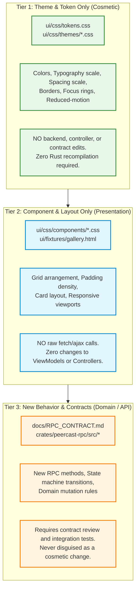
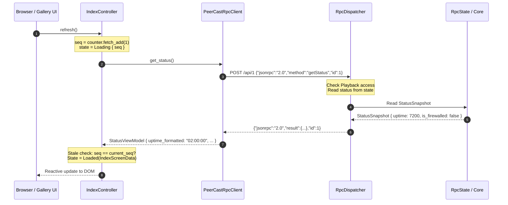
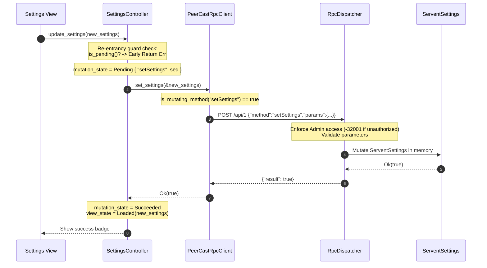

# PeerCastStation Minimal-Context Design Handoff & Architecture Guide

## 1. Executive Summary & Design Change Tiers (REQ-087)

This guide provides exact locations, rules, and commands for modifying PeerCastStation's user interface, styling, and behavior without requiring prior oral context. Any developer or autonomous agent must follow the three strict change tiers defined below.



---

## 2. File Location Map by Design Aspect

| Design Aspect | Authorized Edit Locations | Strictly Forbidden Edit Scope |
|---|---|---|
| **Theme / Colors** | `ui/css/tokens.css`<br>`ui/css/themes/*.css` | `crates/peercast-rpc/src/controller.rs`<br>`crates/peercast-rpc/src/server.rs` |
| **Typography & Fonts** | `ui/css/tokens.css` (`--peca-font-*`) | Any `.rs` source file |
| **Spacing & Padding Scale** | `ui/css/tokens.css` (`--peca-space-*`) | Any `.rs` source file |
| **Component Styles** | `ui/css/components/*.css` | Controllers, API adapter, Backend crates |
| **Layout & Grid Density** | `ui/css/components/compact_layout.css`<br>`ui/fixtures/gallery.html` | Network clients, Dispatcher, Serialization |
| **Copy & Text Labels** | `crates/peercast-rpc/src/client.rs` (ViewModels)<br>`ui/fixtures/*.json` | Raw wire protocols or demuxers |
| **Accessibility / Contrast** | `ui/css/tokens.css` (`[data-theme="high-contrast"]`) | Do not disable outline rings or focus styles |

---

## 3. End-to-End Tracing Examples (REQ-087)

### Trace A: Read Flow (Viewing Servent Status & Channels)



1. **User Action**: The browser loads `index.html` or the offline `gallery.html`.
2. **Controller** ([`crates/peercast-rpc/src/controller.rs`](file:///C:/Github/PeerCastStation_Rust/crates/peercast-rpc/src/controller.rs#L115)):
   - Generates a sequence token `seq` from `AtomicU64`.
   - Atomically updates state to `ScreenState::Loading { seq }`.
3. **API Adapter** ([`crates/peercast-rpc/src/client.rs`](file:///C:/Github/PeerCastStation_Rust/crates/peercast-rpc/src/client.rs#L250)):
   - Encodes JSON-RPC 2.0 payload (`method: "getStatus"`).
   - Issues query through `RpcTransport`.
4. **Backend Server** ([`crates/peercast-rpc/src/server.rs`](file:///C:/Github/PeerCastStation_Rust/crates/peercast-rpc/src/server.rs#L340)):
   - Verifies caller permission (`MethodAccessRequired::Playback`).
   - Reads `StatusSnapshot` from `RpcState`.
5. **Return Path**:
   - `StatusSnapshot` is transformed into presentation-ready `StatusViewModel` (formatting uptime into `HH:MM:SS` and mapping firewalled boolean to Japanese status labels).
   - Controller verifies the sequence token against `seq_counter`. If superseded by a newer query, the stale read is safely dropped (`ControllerError::StaleResponseIgnored`) without corrupting UI state.
   - View transitions to `ScreenState::Loaded`.

---

### Trace B: Mutation Flow (Updating Servent Settings)



1. **User Action**: Administrator clicks "設定を保存 (Save Settings)".
2. **Controller Re-entrancy Guard** ([`crates/peercast-rpc/src/controller.rs`](file:///C:/Github/PeerCastStation_Rust/crates/peercast-rpc/src/controller.rs#L235)):
   - Checks `mutation_state.is_pending()`. If another mutation is currently in flight, **early-returns immediately** with `ControllerError::DuplicatePendingMutation`.
   - Transitions `mutation_state` to `MutationState::Pending { action: "setSettings", seq }`.
3. **API Adapter & Safety Guard** ([`crates/peercast-rpc/src/client.rs`](file:///C:/Github/PeerCastStation_Rust/crates/peercast-rpc/src/client.rs#L336)):
   - Checks `PeerCastRpcClient::is_mutating_method("setSettings") == true`.
   - Dispatches RPC mutation payload.
4. **Backend Security Dispatcher** ([`crates/peercast-rpc/src/server.rs`](file:///C:/Github/PeerCastStation_Rust/crates/peercast-rpc/src/server.rs#L370)):
   - Enforces `MethodAccessRequired::Admin`. Returns `-32001` (`UNAUTHORIZED`) if unauthenticated.
   - Validates ranges (`max_relays`, `max_upstream_rate`).
   - Commits changes to backend `ServentSettings`.
5. **Network Failure & Uncertainty Guard (REQ-084)**:
   - If transport drops mid-flight, controller enters `MutationState::Failed` and returns `ControllerError::UncertainMutationRetryForbidden`.
   - **Blind automatic retries are strictly barred**: The user must review current node state before re-dispatching.

---

## 4. Concrete Before/After Styling Example

### Adding a Custom Brand Accent (Tier 1 Change)

To introduce a new custom accent color, modify only [`ui/css/tokens.css`](file:///C:/Github/PeerCastStation_Rust/ui/css/tokens.css):

```diff
--- a/ui/css/tokens.css
+++ b/ui/css/tokens.css
@@ -21,7 +21,7 @@
   /* Brand & Accent Tokens */
   --peca-color-primary: #034f84;
   --peca-color-primary-hover: #02385e;
-  --peca-color-accent: #2e8ece;
+  --peca-color-accent: #e65100; /* Warm Amber Accent */
```

### Applying High-Density Layout (Tier 2 Change)

To enable high-density views, apply the layout attribute to the root container without touching Rust code:

```html
<!-- Default View -->
<div class="peca-card">...</div>

<!-- High-Density View (Zero Rust or Controller Edits) -->
<div data-density="compact">
  <div class="peca-card">...</div>
</div>
```

---

## 5. Actual Verified Validation Commands

Every change must be validated using the project's actual test runners:

```powershell
# 1. Architectural Boundary Scanner (catches forbidden network/DOM/CSS leaks)
cargo test -p peercast-rpc --test test_p37e_boundary_enforcement

# 2. Design Tokens, Reduced-Motion, & Fixture Gallery Verification
cargo test -p peercast-rpc --test test_p37d_presentation

# 3. Presentation Controllers (Lifecycle, Re-entrancy, Stale-read guards)
cargo test -p peercast-rpc --test test_p37c_controllers

# 4. JSON-RPC Client Adapter & ViewModel Serialization
cargo test -p peercast-rpc --test test_p37b_client_adapter

# 5. Core JSON-RPC 2.0 Backend Contract Freeze
cargo test -p peercast-rpc --test test_p37_rpc_contract

# 6. Full Workspace Verification & Linter
cargo test --workspace
cargo clippy --all-targets --all-features
```
