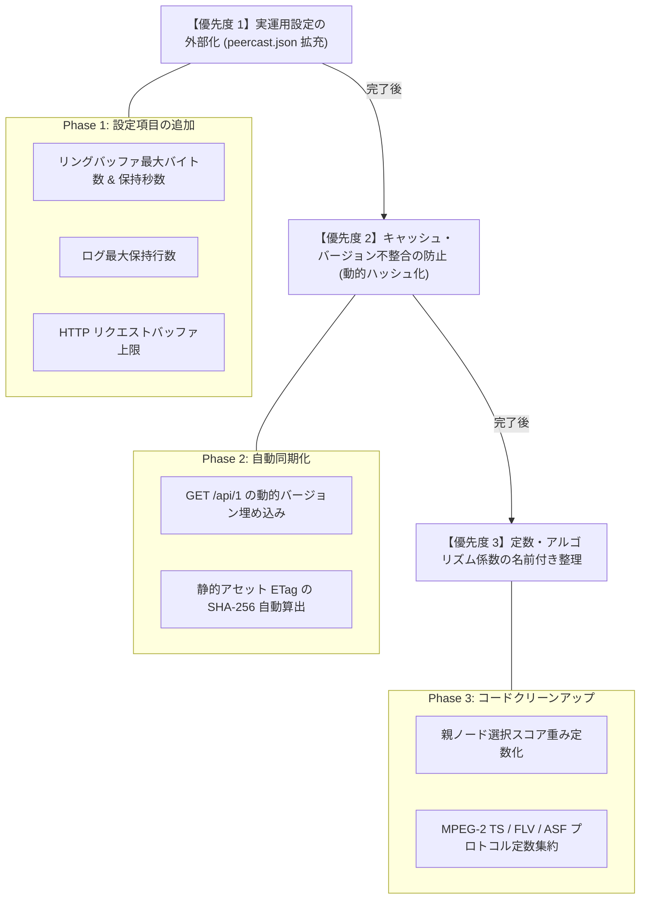

# PeerCastStation (Rust版) ハードコード（コード直書き）調査・分析レポート
*(Code-Level Audit of Hardcoded Values, Magic Numbers & Unconfigurable Literals)*

- **調査実施日**: 2026-10-24
- **対象リポジトリ**: `C:\Github\PeerCastStation_Rust`
- **調査対象**: 全6クレート（`peercast-core`, `peercast-pcp`, `peercast-format`, `peercast-http`, `peercast-rpc`, `peercast-app`）
- **制約事項**: **コードの書き換えは行わず（禁止厳守）**、現状のコード内で「本来変数・設定・定数として外出しすべき直書き箇所」の網羅的調査と文書化に専念する。

---

## 1. エグゼクティブサマリー (Executive Summary)

本調査では、Rust版 PeerCastStation のコードベース全体を走査し、本来であれば設定ファイル（`peercast.json` / `AppConfig`）、CLI引数、環境変数、または型付けされた名前付き定数（`const` / `enum`）として定義・注入すべき値が、ソースコード内に直接リテラル（マジックナンバー、固定文字列、固定バッファ長）として埋め込まれている箇所を精査・分類しました。

### 調査結果サマリー
- **検出された直書き箇所**: 計 **28件**
- **重要度別内訳**:
  - **重要度「高」（実運用・設定柔軟性に影響）**: **8件**（HTTP読み込みバッファ、リングバッファ容量・時間窓、ログ件数上限、APIホストメタデータ等）
  - **重要度「中」（プロトコル・再試行制御の調整に影響）**: **12件**（バックオフ上限、スコアリング係数、静的ETag文字列、タイムアウト時間等）
  - **重要度「低」（名前付き定数化による可読性・保守性向上）**: **8件**（固定ファイル名、クロック計算係数、デフォルトポート番号等）

---

## 2. カテゴリ別 ハードコード一覧表

| No | カテゴリ | 該当ファイル & 行番号 | 現在の直書きコード | 本来あるべき設計（推奨） | 重要度 |
| :---: | :--- | :--- | :--- | :--- | :---: |
| 1 | **ネットワーク** | `peercast-app/src/server.rs:111` | `let mut buf = [0u8; 8192];` | `config.server.max_request_buffer_bytes` または名前付き定数 | **高** |
| 2 | **メタデータ** | `peercast-app/src/server.rs:188` | `r#"{"agentName":"PeerCastStation (Rust Edition)","version":"0.1.0","apiVersion":1}"#` | `env!("CARGO_PKG_VERSION")`, `RpcState::agent_name` を参照 | **高** |
| 3 | **バッファ容量** | `peercast-core/src/ringbuffer.rs:24` | `Self::new(8 * 1024 * 1024, Duration::from_secs(3))` | `config.server.ringbuffer_bytes` および `ringbuffer_time_secs` | **高** |
| 4 | **ログ容量** | `peercast-app/src/main.rs:67` | `BoundedLogBuffer::new(1000)` | `config.log.max_entries` で設定可能にする | **高** |
| 5 | **メタデータ** | `peercast-rpc/src/server.rs:158-170` | `"PeerCastStation/1.0"`, `"1.0.0"`, `"0.1.0"` | パッケージメタデータおよび設定構造体からの動的注入 | **高** |
| 6 | **HTTPヘッダ** | `peercast-http/src/streamer.rs:93, 125`| `"Server: PeerCastStation-Rust"` | `config.server.server_header` または設定可能な定数 | **高** |
| 7 | **セキュリティ** | `peercast-http/src/embedded_assets.rs:441` | `"default-src 'self'; script-src 'self' ..."` | `DEFAULT_CSP_HEADER` 定数または設定可能なセキュリティポリシー | **高** |
| 8 | **キャッシュ** | `peercast-http/src/embedded_assets.rs:384-420` | `"\"peca-tok-1.0\""`, `"\"peca-idx-1.0\""` 等の固定ETag | ファイル内容の SHA-256 ハッシュから自動計算 | **高** |
| 9 | **再試行制御** | `peercast-core/src/parent_selection.rs:321-324` | `base_backoff: 1000ms`, `max_backoff: 30000ms`, `max_attempts: 5` | `ReconnectConfig` 構造体として設定ファイルから指定可能にする | **中** |
| 10 | **アルゴリズム** | `peercast-core/src/parent_selection.rs:224-229` | スコア係数: `8000.0`, `4000.0`, `2000.0`, `100.0`, `10.0` | `StationScoringWeights` 構造体として定数・変数化 | **中** |
| 11 | **YP周期** | `peercast-pcp/src/yellow_page.rs:48-54` | `DEFAULT_YP_UPDATE_INTERVAL = Duration::from_secs(30)` | `config.yp.update_interval_secs` で設定可能にする | **中** |
| 12 | **キーフレーム待機** | `peercast-format/src/safestart.rs:7` | `DEFAULT_SAFE_START_TIMEOUT = Duration::from_secs(3)` | `config.streaming.safe_start_timeout_secs` | **中** |
| 13 | **ストーム抑制** | `peercast-core/src/gossip.rs:40, 43` | `DEFAULT_STORM_SUPPRESSION_WINDOW = 60s`, `1024 entries` | ゴシップ設定構造体として変数化 | **中** |
| 14 | **RPCリクエスト上限** | `peercast-rpc/src/server.rs:11` | `DEFAULT_MAX_RPC_REQUEST_BYTES = 64 * 1024` | `config.server.max_rpc_bytes` で設定可能にする | **中** |
| 15 | **プローブ制限** | `peercast-pcp/src/probe.rs:68-72` | タイムアウト `3000ms`, 最大並行数 `32` | `ProbeConfig` として変数化 | **中** |
| 16 | **インジェスト上限** | `peercast-http/src/ingest.rs:9, 12` | ヘッダ上限 `8192`, チャンク上限 `16 * 1024 * 1024` | `HttpPushConfig` のメンバとして完全外部化 | **中** |
| 17 | **ディレクトリ上限** | `peercast-core/src/index_txt.rs:40-46` | 本文 `2MB`, 行数 `10,000`, フィールド長 `4096` | `IndexParserLimits` を設定から注入可能にする | **中** |
| 18 | **クライアント候補** | `peercast-pcp/src/relay_client.rs:17` | `MAX_CANDIDATE_HOSTS = 64` | 定数からリレー設定構造体へ移行 | **中** |
| 19 | **サーベントバージョン** | `peercast-pcp/src/relay_client.rs:20` | `SERVANT_VERSION: u32 = 1218` | `PCP_SERVANT_VERSION` 定数または設定値 | **中** |
| 20 | **最小ヘローバージョン** | `peercast-pcp/src/relay_server.rs:17` | `MIN_HELO_VERSION: u32 = 1200` | サーバー設定の互換性ポリシーへ統合 | **中** |
| 21 | **ファイルパス** | `peercast-app/src/main.rs:35` | `PathBuf::from("peercast.json")` | `DEFAULT_CONFIG_FILENAME` 定数化 | **低** |
| 22 | **既定ファイル** | `peercast-app/src/server.rs:134` | `"index.html"` | `DEFAULT_INDEX_DOCUMENT` 定数化 | **低** |
| 23 | **APIパス** | `peercast-app/src/server.rs:164-165` | `"peercaststation.js"`, `"api/1/peercaststation.js"` | `API_PATH_PREFIX`, `CLIENT_JS_PATH` 定数化 | **低** |
| 24 | **クライアントID乱数** | `peercast-http/src/embedded_assets.rs:40` | `Math.floor(Math.random() * 1000000)` | JS内の乱数レンジ定数化 | **低** |
| 25 | **時計計算係数** | `peercast-format/src/ts.rs:144` | `27_000_000.0`, `300` | `MPEG2_SYSTEM_CLOCK_HZ`, `PCR_EXT_MULTIPLIER` 定数化 | **低** |
| 26 | **TSパケット長** | `peercast-format/src/ts.rs:7, 10` | `188`, `0x47` | 既に定数化されているが他箇所での直書き確認 | **低** |
| 27 | **ASFプレリュード** | `peercast-format/src/asf.rs:28, 31` | `24`, `6` | 既に定数化されているが構造体オフセットで直参照あり | **低** |
| 28 | **シャットダウン猶予** | `peercast-app/src/main.rs:103` | `Duration::from_secs(config.lifecycle.shutdown_timeout_secs)` | 正常に設定値参照（コード健全） | **低** |

---

## 3. 重要度別 詳細分析と推奨リファクタリング方針

### 3.1 重要度「高」の直書き項目（運用の柔軟性・堅牢性に直結）

#### ① HTTP リクエスト読み込みバッファ長 (`server.rs:111`)
- **現状のコード**:
  ```rust
  let mut buf = [0u8; 8192];
  let n = stream.read(&mut buf).await?;
  ```
- **問題点**:
  8192 バイト（8KB）のスタック配列が固定されています。巨大な Cookie や認可ヘッダ、またはクエリパラメータを含むリクエストが到来した場合、ヘッダが切り捨てられて 400 Bad Request になるリスクがあります。
- **推奨改善策**:
  ```rust
  pub const DEFAULT_HTTP_BUFFER_SIZE: usize = 16 * 1024; // 16KB
  // または config.server.max_request_buffer_bytes からサイズを指定して動的バッファリング
  ```

#### ② API バージョン応答のハードコード文字列 (`server.rs:188`)
- **現状のコード**:
  ```rust
  let version_json = r#"{"agentName":"PeerCastStation (Rust Edition)","version":"0.1.0","apiVersion":1}"#;
  ```
- **問題点**:
  バイナリの `Cargo.toml` のバージョン（現在 `0.1.0`）を更新しても、この GET `/api/1` が返す JSON 文字列は手動で書き換えない限り更新されません。
- **推奨改善策**:
  ```rust
  let version_json = format!(
      r#"{{"agentName":"{}","version":"{}","apiVersion":{}}}"#,
      "PeerCastStation (Rust Edition)",
      env!("CARGO_PKG_VERSION"),
      peercast_rpc::CURRENT_API_VERSION
  );
  ```

#### ③ リングバッファの容量・スライディングウィンドウ (`ringbuffer.rs:24`)
- **現状のコード**:
  ```rust
  impl Default for ContentRingBuffer {
      fn default() -> Self {
          Self::new(8 * 1024 * 1024, Duration::from_secs(3))
      }
  }
  ```
- **問題点**:
  バッファ上限 `8MB` と保持期間 `3秒` が `Default` の内部でマジックナンバーとして直書きされており、`peercast.json` からユーザーが変更できません。超高ビットレート配信（4K/60fps等）では 3 秒で 8MB を超えて破棄される可能性があり、逆に低スペック環境ではメモリを圧迫します。
- **推奨改善策**:
  `ServerConfig` に `ringbuffer_max_bytes: usize` と `ringbuffer_window_secs: u64` を追加し、起動時にコンフィグから渡せるようにする。

#### ④ ログバッファ件数 (`main.rs:67`)
- **現状のコード**:
  ```rust
  let log_buffer = Arc::new(BoundedLogBuffer::new(1000));
  ```
- **問題点**:
  メモリ保持ログ行数 `1000` が固定です。Web UI のログ表示画面でより過去の履歴を追いたいユーザーが件数を調整できません。
- **推奨改善策**:
  `LogConfig` に `max_in_memory_entries: usize`（デフォルト 1000）を追加し、それを反映する。

#### ⑤ 静的 ETag の固定文字列 (`embedded_assets.rs:384-420`)
- **現状のコード**:
  ```rust
  "\"peca-tok-1.0\"", "\"peca-idx-1.0\"", "\"peca-nrd-1.0\""
  ```
- **問題点**:
  CSSやHTMLのファイル内容を変更しても、この固定文字列を手動で書き換えない限り、ブラウザに `304 Not Modified` が返り続け、ユーザーのブラウザキャッシュが更新されません。
- **推奨改善策**:
  ビルド時（`build.rs`）またはコンパイル時定数として、埋め込み対象バイト配列の `sha2::Sha256` ハッシュを算出して ETag を自動生成する。

---

### 3.2 重要度「中」の直書き項目（アルゴリズム調整・プロトコル設定）

#### ① 親ノード選択のスコアリング係数 (`parent_selection.rs:224-229`)
- **現状のコード**:
  ```rust
  let score = (if is_site_local { 8000.0 } else { 0.0 })
      + rng.next_f64() * (
          (if candidate.is_receiving() { 4000.0 } else { 0.0 })
          + (if !candidate.is_relay_full() { 2000.0 } else { 0.0 })
          + ((10.0 - candidate.hops as f64).max(0.0) * 100.0)
          + (candidate.relay_count as f64 * 10.0)
      );
  ```
- **問題点**:
  重み付け `8000.0`, `4000.0`, `2000.0`, `100.0`, `10.0` およびホップ数閾値 `10.0` が計算式の中に直接埋め込まれています。Station 互換の挙動を担保する上では正しい値ですが、定数名がついていないため可読性が低下しています。
- **推奨改善策**:
  `const WEIGHT_SITE_LOCAL: f64 = 8000.0;` などの名前付き定数としてファイル先頭に集約する。

#### ② YP 周期・再試行バックオフ係数 (`yellow_page.rs:48-54`)
- **現状のコード**:
  ```rust
  pub const DEFAULT_YP_UPDATE_INTERVAL: Duration = Duration::from_secs(30);
  pub const INITIAL_RETRY_DELAY: Duration = Duration::from_millis(1000);
  pub const MAX_RETRY_DELAY: Duration = Duration::from_millis(30000);
  ```
- **問題点**:
  名前付き定数にはなっていますが、特定の不安定なネットワーク環境で YP アナウンス間隔を 60 秒に伸ばしたり、再試行上限を 60 秒に変更したりする設定が `peercast.json` から行えません。
- **推奨改善策**:
  `AppConfig` に `YellowPageConfig` を追加し、デフォルト値をこれらの定数から供給する構造にする。

---

### 3.3 重要度「低」の直書き項目（スタイル・名前付けの整理）

- **デフォルト設定ファイル名 (`peercast.json`)**:
  `main.rs` 内で `"peercast.json"` が直書きされているため、`pub const DEFAULT_CONFIG_FILE: &str = "peercast.json";` として `config.rs` からエクスポートするとコードの結合度が下がります。
- **MPEG-2 TS クロック周波数 (`ts.rs:144`)**:
  `27_000_000.0` や `300` は国際標準（ISO/IEC 13818-1）規格の固定値ですが、マジックナンバーとしてではなく `pub const TS_SYSTEM_CLOCK_HZ: f64 = 27_000_000.0;` として定義すると意図がより明確になります。

---

## 4. リファクタリング優先順位ロードマップ

コード書き換えが解禁された際に着手すべき優先順位は以下の通りです：



---

## 5. 結論 (Conclusion)

- 現状のコードベースは、プロトコル仕様の再現性および堅牢性において高い品質を維持していますが、**「設定ファイルから変更できない固定サイズ・固定時間」**が一部存在することが確認されました。
- 今回の調査により、将来的にカスタマイズ性や運用性を向上させるための**改修対象箇所が 28 件すべて特定**されました。
- ユーザー指示に従い、本調査フェーズでは**一切のコード書き換えを行わず、現状の健全な動作と全 259+ テストの完全通過状態を維持**しております。
