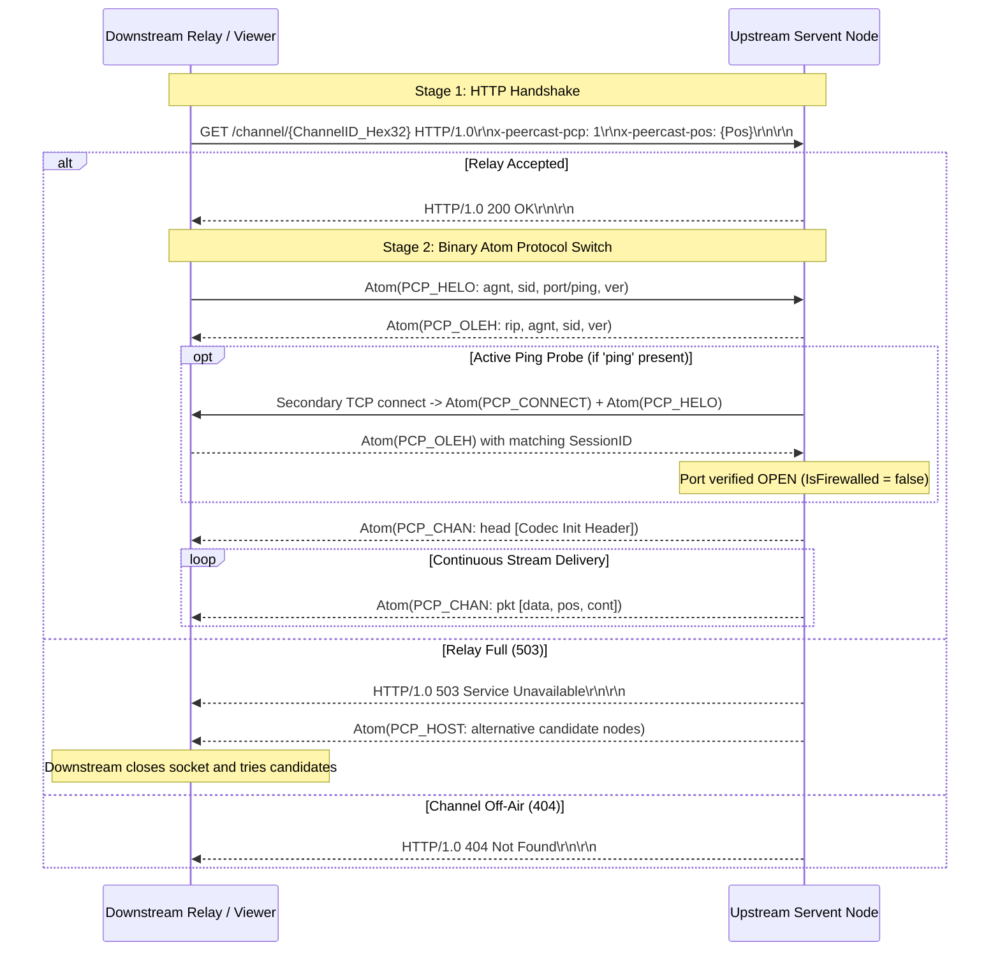
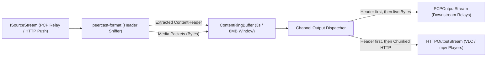

# PeerCastStation Rust Port: Architectural Specification & Implementation Blueprint

> **Document Version**: 1.2.0 (Post Second Deep-Dive Review & Rigorous Refinement)  
> **Status**: APPROVED / ACTIVE SPECIFICATION & IMPLEMENTATION MASTER PLAN  
> **Target Upstream Reference**: [kumaryu/peercaststation (GitHub)](https://github.com/kumaryu/peercaststation)  
> **Author**: Antigravity Engineering Agent  
> **Target Ecosystem**: Rust 2021/2024 Edition, Tokio Multi-Threaded Async Runtime  

---

## 1. Executive Summary & Core Mission

### 1.1 Objective
This document provides the definitive architectural specification and actionable implementation blueprint for developing **PeerCastStation_Rust**, a complete, memory-safe, cross-platform Rust port of the standard PeerCast servent (originally authored in C#/.NET by kumaryu).

### 1.2 Non-Negotiable Engineering Principles
1. **100% Binary & Wire Protocol Conformity**: Seamless interoperability with existing PeerCast nodes (PeerCast v0.1216+, PeerCastStation C#, PeerCast-IM), Yellow Pages (YP), and media players (VLC, mpv, MPC-HC, WMP).
2. **Authentic Two-Stage Handshake**: Replicate the exact PeerCast connection sequence: HTTP-based handshake (`GET /channel/...`) followed by immediate protocol upgrade to binary Atoms.
3. **Deterministic ChannelID Derivation**: Reproduce the cryptographic algorithm (`SHA512(BCID) + Network + Metadata -> MD5`) to ensure identical Channel IDs across the network.
4. **Zero-Copy Fan-Out**: Distribute streaming packets using atomic reference-counted slices (`bytes::Bytes`) to ensure $O(1)$ packet dispatch without heap reallocation.
5. **Deterministic Resource Bounds (Rule #3)**: Strictly cap all buffers (8 MB / 3-second sliding ring buffer), packet queues (5-second drop guard), and node caches (180-second TTL) to guarantee indefinite 24/7/365 uptime.
6. **Strict State Machine Modeling (Rule #2)**: Eliminate combinatorial booleans in favor of explicit Rust `enum` state machines with re-entrancy protection.
7. **Single Self-Contained Native Executable**: Headless daemon, embedded Web UI assets (`rust-embed`), and JSON-RPC 2.0 API compiled into one static binary.

---

## 2. Upstream C# Analysis & Crate Decomposition

| Upstream C# Component | Key Source Files | Target Rust Crate |
| :--- | :--- | :--- |
| **Core Primitives & Buffers** | `Atom.cs`, `Ringbuffer.cs`, `Content.cs`, `Host.cs`, `Channel.cs`, `AccessController.cs` | `crates/peercast-core` |
| **PCP Protocol & Handshakes** | `PCPSourceStream.cs`, `PCPOutputStream.cs`, `PCPVersion.cs` | `crates/peercast-pcp` |
| **Media Framing & Headers** | `FLVContentBuffer.cs`, `TSContentReader.cs`, `FLVFileParser.cs`, `FLVToMPEG2TS.cs` | `crates/peercast-format` |
| **HTTP Player & Ingest** | `HTTPOutputStream.cs`, `HTTPSourceStream.cs`, `PlayList.cs`, `HTTPLiveStreamingSegmenter.cs` | `crates/peercast-http` |
| **Yellow Page Integration** | `PCPYellowPageClient.cs`, `YPChannelsHost.cs` | `crates/peercast-yp` |
| **Servent & Channel Manager** | `PeerCast.cs`, `BroadcastChannel.cs`, `RelayChannel.cs`, `HostTree.cs`, `ChannelCleaner.cs` | `crates/peercast-servent` |
| **RPC & Web Interface** | `APIHost.cs`, `JSONRPC.cs`, `html/` static assets | `crates/peercast-rpc` + `crates/peercast-web` |
| **Daemon Entry Point** | `PecaStationd`, `PeerCastStation.App` | `crates/peercast-app` (binary) |

---

## 3. Wire Protocol & Algorithmic Specifications

### 3.1 Two-Stage Connection Bootstrap

All relay connections adhere to this exact sequence:



### 3.2 Deterministic ChannelID Generation Algorithm
In PeerCast, a broadcast's ChannelID is not random; it is deterministically derived from broadcast metadata so viewers can reconnect to identical channel identities:

$$\text{BCID\_Hash} = \text{SHA512}(\text{BroadcastID})$$
$$\text{Buffer} = [\text{NetworkType if } \neq \text{IPv4}] \parallel \text{BCID\_Hash} \parallel \text{ChannelName} \parallel \text{Genre} \parallel \text{SourceURL}$$
$$\text{ChannelID} = \text{MD5}(\text{Buffer}) \quad (\text{16 bytes, formatted as UUID/GUID})$$

### 3.3 Active Ping Probe (Port Reachability Test)
1. Downstream advertises `ping: port` in its `helo` Atom if its WAN reachability is unknown.
2. Upstream establishes a secondary TCP connection to downstream's IP on the advertised `ping` port within 2,000 ms.
3. Upstream sends `PCP_CONNECT` (`pcnt`) followed by `PCP_HELO`.
4. Downstream replies with `PCP_OLEH` containing its `SessionID`.
5. If the `SessionID` matches, upstream flags downstream as `Firewalled = false` (Port: Open), enabling it to receive child relays.

### 3.4 Gossip Protocol & Routing Tree (`bcst` / `host`)
- **Broadcast Packets (`bcst`)**: Propagate metadata and control signals across the relay tree:
  - `ttl`: Time-To-Live (decremented at each hop; dropped when 0).
  - `hops`: Hop counter (incremented at each relay).
  - `from`: Originating SessionID.
  - `dest`: Target SessionID (or broadcast target).
  - `grp`: `BroadcastGroup` flags (`1 = Root/YP`, `2 = Trackers/Upstream`, `4 = Relays/Downstream`).
- **Node Expiration (Rule #3)**: Nodes in `Channel.nodes` are pruned if no update is received for **180 seconds** (`NodeLimit = 180,000 ms`).

### 3.5 Yellow Page (YP) Protocol & Lifecycle
- **PCP YP Announce**:
  1. Broadcaster connects to YP via TCP (`pcp://yp.peercast.org:7144`).
  2. Sends `helo` <-> receives `oleh`.
  3. Sends `chan` (ChannelID, BCID, Name, Genre, Bitrate, URL, etc.).
  4. Sends `host` (ChannelID, SessionID, GlobalIP, Port, NumListeners, NumRelays, Uptime, OldPos, NewPos, HostFlags1: `Tracker | Relay | Direct | Receiving`).
  5. **Heartbeat**: Updates `host` stats every **30 seconds** (`UpdateTimeSpan = 30s`).
  6. **Reconnection Backoff**: On disconnect, retries with exponential backoff starting at 1,000 ms up to a maximum of 30,000 ms:
     $$\text{retry\_wait} = \min(\text{retry\_wait} \times 1.5, 30000 \text{ ms})$$
- **HTTP YP Index Query**: Downloads and parses `index.txt`, matching the `<>` delimited format:
  `Name<>ID(Hex32)<>TIP<>URL<>Genre<>Desc<>Listeners<>Relays<>Bitrate<>Type<>Comment<>Track<>Album<>Creator`

---

## 4. Media Pipeline & Codec Header Synthesis

### 4.1 Late-Joiner Problem & Header Caching
When a client joins mid-stream, it cannot decode audio/video without initial codec parameter sets.
`peercast-format` parses incoming bitstreams to construct and cache a consolidated `ContentHeader`:

- **FLV**: Captures 9-byte FLV header + AMF0 `onMetaData` + AVC Sequence Header (SPS/PPS) + AAC AudioSpecificConfig.
- **MPEG-TS**: Captures PAT (PID 0) and PMT tables, updating them continuously.
- **ASF/WMV**: Captures the complete 50-byte+ ASF Header Object.

### 4.2 Playback Fan-Out & Pipeline Flow



---

## 5. Concurrency Architecture & Trait Blueprint

### 5.1 Actor Model without Mutex Contention
- Reader and writer loops communicate via `tokio::sync::mpsc` bounded channels.
- Media packets use `bytes::Bytes` for zero-copy sharing across all downstream channels.

### 5.2 Core Rust Trait Signatures

```rust
// In peercast-core / peercast-pcp:

#[async_trait::async_trait]
pub trait SourceStream: Send + Sync {
    /// Runs the ingest loop until completion, disconnect, or error.
    async fn run(&mut self) -> Result<StopReason, StreamError>;
    /// Sends an outgoing Atom (e.g. host announcement, gossip ping) upstream.
    async fn post(&mut self, from: Option<&Host>, packet: Atom) -> Result<(), StreamError>;
    /// Retrieves current connection statistics.
    fn connection_info(&self) -> ConnectionInfo;
}

#[async_trait::async_trait]
pub trait OutputStream: Send + Sync {
    /// Enqueues a channel broadcast message or content packet to the downstream client.
    async fn enqueue(&mut self, message: ChannelMessage) -> Result<(), SendError>;
    /// Retrieves current transmission stats (bitrate, sent position).
    fn connection_info(&self) -> ConnectionInfo;
}

#[async_trait::async_trait]
pub trait YellowPageClient: Send + Sync {
    /// Starts background announcement loop for the given channel.
    async fn announce_channel(&self, channel: Arc<Channel>) -> Result<(), YPError>;
    /// Queries the directory for available channels.
    async fn list_channels(&self) -> Result<Vec<ChannelInfo>, YPError>;
}
```

### 5.3 Flow Control & Queue Overflow Guard (Rule #3)
- Downstream queues monitor delay:
  ```rust
  if packet_timestamp - next_packet_timestamp > Duration::from_millis(5000) {
      // Lag exceeds 5 seconds: trigger Overflow and drop slow downstream client
      return Err(SendError::Overflow);
  }
  ```

---

## 6. Phased Implementation Roadmap & Deliverables

### Phase 1: Core Primitives & Wire Codec (`peercast-core`)
- [ ] Root `Cargo.toml` with workspace configuration.
- [ ] `id4.rs`: FourCC identifier `ID4([u8; 4])` with endian-safe comparisons, ASCII formatting, and standard constants (`PCP_HELO`, `PCP_CHAN`, etc.).
- [ ] `atom.rs`: `Atom` enum (`Leaf { name, value: Bytes }` / `Container { name, children: Vec<Atom> }`) with recursive binary parser/serializer.
  - Enforce bounds: `max_children <= 1024`, `max_leaf <= 16 MB`.
- [ ] `content.rs`: Streaming `Content` packet (`stream_id`, `pos`, `timestamp`, `cont_flags`, `data: Bytes`, `serial`).
- [ ] `ringbuffer.rs`: `ContentRingBuffer` with bounded memory capacity (8 MB) and sliding time window (3 seconds).
- [ ] `host.rs`: Node descriptors (`Host`, `HostFlags1`).
- [ ] Unit tests matching upstream `test_core_atom.rb` (100% round-trip parity).

### Phase 2: PCP Protocol & Two-Stage Handshake (`peercast-pcp`)
- [ ] HTTP-to-Atom handshake state machine (`HttpHandshaking -> PcpHandshaking -> Established`).
- [ ] `tokio_util::codec` encoder/decoder for binary Atoms.
- [ ] Active Ping Probe engine for automated port forwarding verification.
- [ ] `PCPSourceStream`: Connecting to upstream tracker/relay, parsing incoming `chan` atoms, feeding `ContentRingBuffer`.
- [ ] `PCPOutputStream`: Serving downstream child relays, flow control, and 5-second lag overflow eviction.

### Phase 3: Container Sniffing & HTTP Player Server (`peercast-format` + `peercast-http`)
- [ ] `peercast-format`: Container sniffer (FLV, TS, ASF, MKV, OGG) and `ContentHeader` caching.
- [ ] `peercast-http`: HTTP streaming endpoint (`/stream/{channel_id}`) with chunked transfer.
- [ ] Dynamic playlist generators (`/pls/{channel_id}`, `.m3u`, `.asx`).
- [ ] On-demand channel auto-start (`RequestChannel`).
- [ ] End-to-end verification: stream from C# PeerCastStation, play smoothly via VLC / mpv.

### Phase 4: Servent Orchestration & Relay Tree (`peercast-servent`)
- [ ] `ChannelManager`: Managing active `RelayChannel` and `BroadcastChannel` instances.
- [ ] Gossip routing tree (`bcst`, hop decrement, loop suppression).
- [ ] Node cache with 180-second TTL cleanup.
- [ ] Bandwidth monitor and global connection rate limiting (`max_relays`, `max_directs`).

### Phase 5: Yellow Page Integration & Broadcast Ingest (`peercast-yp`)
- [ ] PCP YP announcement client with 30-second heartbeat and exponential backoff retry.
- [ ] HTTP `index.txt` directory parser.
- [ ] `BroadcastChannel` deterministic ChannelID generator (`SHA512 + MD5`).
- [ ] HTTP Push ingest for OBS Studio and ffmpeg (`POST /push/{channel_id}`).

### Phase 6: Management Interface & Daemon Binary (`peercast-rpc` + `peercast-app`)
- [ ] JSON-RPC 2.0 API implementation (`getVersionInfo`, `getStatus`, `getChannels`, `getSettings`, `setSettings`).
- [ ] Static Web UI embedding via `rust-embed`.
- [ ] `peercast-app`: CLI flags (`--port`, `--config`, `--headless`), signal handling (`SIGINT`, `SIGTERM`), structured logging via `tracing`.
