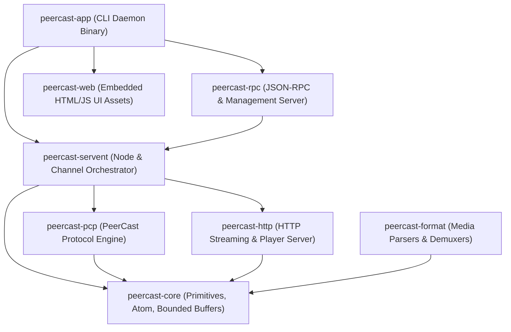
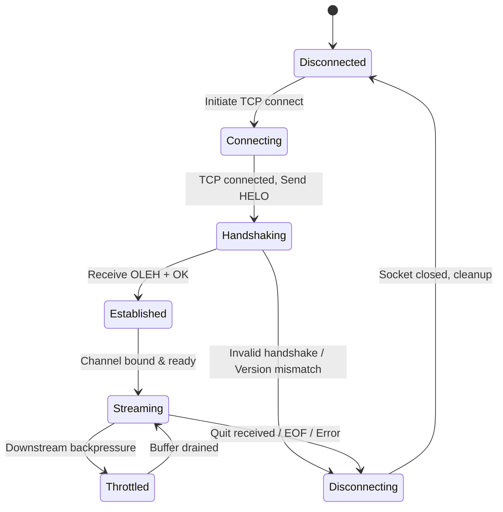

# PeerCastStation Rust Port: Architectural & Technical Specification

> **Document Version**: 1.0.0  
> **Status**: APPROVED / ACTIVE DRAFT  
> **Target Upstream Reference**: [kumaryu/peercaststation (GitHub)](https://github.com/kumaryu/peercaststation)  
> **Author**: Antigravity Engineering Agent  
> **Target Ecosystem**: Rust 2021/2024 Edition, Tokio Async Runtime  

---

## 1. Executive Summary & Goals

### 1.1 Objective
This document outlines the complete architectural design and technical specification for porting **PeerCastStation**—a modern C#/.NET implementation of the PeerCast P2P streaming protocol—to **Rust**.

### 1.2 Core Design Principles
1. **100% Binary & Protocol Interoperability**: Flawlessly communicate with existing PeerCast nodes (PeerCast v0.1216+, PeerCastStation C#, PeerCast-IM) and Yellow Pages (YP: SP, TP, etc.).
2. **Zero-Copy & Memory Safety**: Leverage Rust's ownership model and `bytes::Bytes` to distribute media chunks to hundreds of downstream relays/listeners with zero buffer copying.
3. **Deterministic Resource Bounds (Longevity by Design)**: Enforce strict bounded queues, ring buffers, and node caches. Eliminate unbounded growth, memory leaks, and socket descriptor exhaustion for continuous 24/7/365 uptime.
4. **Strict State Machine Formalization**: All asynchronous connections, channel lifecycles, and relay handshakes are modeled with explicit Rust `enum` state machines with re-entrancy protection.
5. **Modular Multi-Crate Architecture**: Clean isolation between core protocol primitives, transport, media framing, servents, and management APIs.
6. **Cross-Platform Headless Daemon First**: Optimized for Windows, Linux, and macOS headless deployment, accompanied by an embedded web interface (`rust-embed`) and JSON-RPC API.

---

## 2. Upstream C# Codebase Analysis & Decomposition

Upstream PeerCastStation is structured as multiple .NET assemblies. Below is the mapping from the C# source architecture to the Rust workspace crates:

| Upstream C# Project | Primary Responsibilities | Target Rust Crate |
| :--- | :--- | :--- |
| `PeerCastStation.Core` | `Atom`, `ID4`, `Host`, `HostTree`, `Content`, `Ringbuffer`, `Channel`, `PeerCast` servent base, Access Controller, Bandwidth checker | `peercast-core` |
| `PeerCastStation.PCP` | PeerCast Protocol (PCP) packet serialization, `PCPOutputStream`, `PCPSourceStream`, `PCPYellowPageClient`, handshake | `peercast-pcp` |
| `PeerCastStation.HTTP` | HTTP client/server, player stream endpoints (`/stream/`, `/pls/`), HLS chunking/playlist, HTTP push source | `peercast-http` |
| `PeerCastStation.FLV`, `.TS`, `.ASF`, `.MKV` | Container parsing, header detection, stream metadata extraction, FLV-to-TS conversion | `peercast-format` |
| `PeerCastStation.UI.HTTP` | HTTP Admin/API server, JSON-RPC 2.0 endpoints, embedded web UI static files | `peercast-rpc` + `peercast-web` |
| `PecaStationd` / `PeerCastStation.App` | CLI entry point, daemon runner, configuration persistence, graceful shutdown | `peercast-app` (binary) |

---

## 3. Rust Workspace Architecture

The project is organized as a Cargo workspace with granular crates:



### 3.1 Crate Breakdown

#### 1. `peercast-core`
- **Zero I/O dependency**; completely standalone and highly testable.
- **`ID4`**: 4-byte FourCC identifier (`[u8; 4]`), supporting ASCII conversion, endian-independent equality, and display.
- **`Atom`**: Fundamental PCP data unit. Can represent a leaf value (`Atom::Value(ID4, Bytes)`) or a container (`Atom::Container(ID4, Vec<Atom>)`).
- **`Content`**: Represents a streaming packet slice (`stream_id: u32`, `pos: u64`, `timestamp: Duration`, `cont_flags: PacketContinuation`, `data: Bytes`, `serial: u64`).
- **`ContentRingBuffer`**: Thread-safe, bounded, sliding-window ring buffer for streaming packets. Drops packets exceeding the retention time limit (default: 3 seconds) or buffer capacity.
- **`Host`**: Node descriptor (IP, Port, SessionID, BroadcastID, RelayCount, DirectCount, Flags).

#### 2. `peercast-pcp`
- **PCP Wire Codec**: Framed encoder and decoder for PCP Atoms using `tokio_util::codec`.
- **PCP Handshake Engine**: Bi-directional handshake state machine (`helo` <-> `oleh`, `ping` <-> `pong`, `bcst`, `quit`).
- **`PCPSourceStream`**: Connects to an upstream tracker/relay, maintains connection keep-alive, receives incoming stream atoms (`chan`), and feeds the channel buffer.
- **`PCPOutputStream`**: Serves downstream relay nodes, transmits stream packets, handles push notifications, and processes flow-control bump/quit signals.
- **`PCPYellowPageClient`**: Manages registration, channel announcement, and tracker discovery with PCP-based Yellow Pages.

#### 3. `peercast-format`
- **Format Sniffer**: Inspects stream header bytes to identify stream format (`FLV`, `MPEG-TS`, `WMV/ASF`, `MKV/WebM`, `OGG`, `Raw Bitstream`).
- **Header Caching**: Captures codec initialization headers (e.g., FLV Header + Metadata + Sequence Headers) to send immediately to newly connected listeners.
- **Segmenter (HLS)**: Optional segmenter to slice TS streams for HLS/m3u8 browser playback.

#### 4. `peercast-http`
- **Streaming HTTP Server**: Serves standard media players (VLC, mpv, browser, MPC-HC) via chunked HTTP streaming (`/stream/{channel_id}`).
- **Playlist Generator**: Generates `.pls`, `.m3u`, `.asx` playlists dynamically.
- **HTTP Source Stream**: Ingests streams pushed by external encoders (OBS Studio, ffmpeg) via HTTP POST / PUT.
- **HTTP Yellow Page Client**: Supports HTTP-based YP protocols (e.g., Yellow Pages querying via HTTP GET / announce).

#### 5. `peercast-servent`
- **Central Coordinator**: Manages active channels (`BroadcastChannel` and `RelayChannel`).
- **Routing & Tree Management**: Oversees node trees, hop counts, bumps, tracker selection, and leaf discovery.
- **NAT Traversal & Port Mapping**: UPnP (via `igd-next` or `hyper-upnp`) and NAT-PMP port forwarding helpers.
- **Access Controller**: IP-based access filtering (Local only vs WAN permitted).
- **Bandwidth Monitor**: Global and per-connection bandwidth tracking.

#### 6. `peercast-rpc` & `peercast-web`
- **JSON-RPC 2.0 Engine**: Drop-in compatible with upstream PeerCastStation JSON-RPC API (channel list, start relay, stop relay, channel info, servent stats, settings).
- **Embedded Web UI**: Static assets from upstream (`channels.html`, `relays.html`, `settings.html`, `logs.html`) embedded into the binary using `rust-embed`.

#### 7. `peercast-app`
- **Daemon Binary**: Command-line arguments (`--port`, `--config`, `--headless`), signal handlers (`SIGINT`, `SIGTERM`), and logging setup (`tracing-subscriber`).

---

## 4. PCP Protocol Wire Specification

### 4.1 Atom Binary Wire Format

The PCP protocol uses a recursive tag-length-value binary format:

```text
 0                   1                   2                   3
 0 1 2 3 4 5 6 7 8 9 0 1 2 3 4 5 6 7 8 9 0 1 2 3 4 5 6 7 8 9 0 1
+-+-+-+-+-+-+-+-+-+-+-+-+-+-+-+-+-+-+-+-+-+-+-+-+-+-+-+-+-+-+-+-+
|                       Name (4 ASCII Bytes)                    |
+-+-+-+-+-+-+-+-+-+-+-+-+-+-+-+-+-+-+-+-+-+-+-+-+-+-+-+-+-+-+-+-+
|C|                       Length or Child Count                 |
+-+-+-+-+-+-+-+-+-+-+-+-+-+-+-+-+-+-+-+-+-+-+-+-+-+-+-+-+-+-+-+-+
|                       Value Bytes (if C == 0)                 |
|                       or Child Atoms (if C == 1)              |
+-+-+-+-+-+-+-+-+-+-+-+-+-+-+-+-+-+-+-+-+-+-+-+-+-+-+-+-+-+-+-+-+
```

1. **Name** (`ID4`): 4-byte identifier (e.g. `helo`, `oleh`, `chan`, `pkt `).
2. **Length / Flag** (`u32` Little-Endian):
   - **Bit 31 (MSB, `0x8000_0000`) = 0**: Leaf Atom. Lower 31 bits represent byte length of `Value`.
   - **Bit 31 (MSB, `0x8000_0000`) = 1**: Container Atom. Lower 31 bits represent number of direct child atoms.
3. **Safety Limit**: In accordance with upstream and Rule #3 (Resource Bounds), child count is strictly capped at `1024` children, and leaf byte length is capped at `16 MB` per Atom to prevent memory exhaustion attacks.

### 4.2 Core Atom Tags

| Name (ID4) | Meaning | Payload Type | Description |
| :--- | :--- | :--- | :--- |
| `helo` | Hello Handshake | Container | Initiates connection; contains agent, session, port, version |
| `oleh` | Hello Acknowledge | Container | Response to `helo`; contains remote IP/port, session info |
| `ok  ` | Success Response | Empty / Value | Handshake acknowledged and approved |
| `quit` | Disconnect Notice | Value / Container | Graceful disconnect with reason code |
| `chan` | Channel Command | Container | Channel stream transport container |
| `id  ` | Channel ID | 16-byte UUID | 128-bit GUID identifying channel |
| `bcid` | Broadcast ID | 16-byte UUID | 128-bit GUID identifying the broadcast instance |
| `pkt ` | Channel Packet | Container | Encapsulates media packet: `type`, `pos`, `cont`, `data` |
| `head` | Header Content | Value (Bytes) | Codec configuration header (sent once on connect) |
| `data` | Media Content | Value (Bytes) | Raw media payload chunk |
| `pos ` | Stream Position | 4 or 8-byte int | Monotonically increasing byte position in stream |
| `cont` | Continuation Flag | 1 byte bitmask | `0x01`: Fragment, `0x02`: InterFrame, `0x04`: AudioFrame |
| `bcst` | Broadcast Packet | Container | Gossip routing packet: `ttl`, `hops`, `from`, `dest`, `grp` |
| `host` | Host Node Info | Container | Node IP, port, listener count, relay count, flags |
| `ping` | Ping Request | Container / Empty| Keep-alive ping |
| `pong` | Pong Response | Container / Empty| Keep-alive response |

---

## 5. State Machine & Concurrency Architecture

### 5.1 Async Concurrency Pattern (Actor Model)

To avoid mutex contention and deadlocks:
1. **No Shared Mutex Across I/O Loops**: Network reader and writer tasks communicate exclusively via asynchronous bounded channels (`tokio::sync::mpsc`).
2. **Channel Actor**: Each active streaming channel is managed by a single channel actor. External requests (add listener, bump relay, update metadata) arrive via message channels.
3. **Zero-Copy Broadcasting**: Incoming media chunks from the `SourceStream` are converted into immutable `bytes::Bytes` and dispatched to all active `OutputStream` reader queues via Tokio's broadcast channel or bounded ring buffer cursors.

### 5.2 Strict Connection State Machine

Every PCP connection follows an explicit state machine:



### 5.3 Re-entrancy Guards
- As per Global Engineering Rule #2, functions managing state transitions must guard against duplicate invocation. If an event fires while in `Connecting` or `Disconnecting`, it returns early immediately without queuing redundant transitions.

---

## 6. Longevity, Memory Bounding & Defensive Protocols

To guarantee continuous operation (Rule #3):
1. **Ring Buffer Bounding**:
   - The stream buffer allocates a fixed capacity (e.g., maximum 8 MB or 3 seconds of stream duration).
   - Once full, incoming chunks push the tail pointer, automatically evicting oldest chunks.
2. **Backpressure & Slow Client Disconnect**:
   - If a downstream relay or player falls behind the ring buffer's minimum cursor position (due to slow network or stall), it is gracefully bumped/disconnected rather than allowing memory to grow.
3. **Socket & File Descriptor Capping**:
   - Total concurrent connections (relays + directs) are strictly capped by configuration (`max_relays`, `max_directs`).
   - Sockets idle longer than keep-alive timeouts (default: 30 seconds without valid Atom) are actively purged.

---

## 7. Migration & Phased Roadmap

| Phase | Milestone | Expected Deliverable |
| :---: | :--- | :--- |
| **Phase 1** | **Core Primitives & Wire Codec** | `peercast-core` (`ID4`, `Atom`, `Content`, `ContentRingBuffer`, serializer/deserializer with round-trip unit tests). |
| **Phase 2** | **PCP Protocol & Codec framing** | `peercast-pcp` (Tokio Framed codec, HELO/OLEH handshake engine, Ping/Pong, channel packet framing). |
| **Phase 3** | **Stream Ingestion & HTTP Output** | `peercast-http` + `peercast-format` (Serving VLC/mpv via HTTP `/stream/{channel_id}`, FLV/TS container sniffing, header replay). |
| **Phase 4** | **P2P Relay & Channel Orchestration** | `peercast-servent` (`RelayChannel`, connecting to existing PeerCast nodes, tree propagation, node keep-alive). |
| **Phase 5** | **Broadcasting & Yellow Page Integration** | Broadcast source ingestion (OBS/ffmpeg push), YP announce/heartbeat (PCP & HTTP YP). |
| **Phase 6** | **Management Server & Web UI** | `peercast-rpc` (JSON-RPC 2.0), `peercast-web` (embedded HTML/JS UI), configuration engine, CLI binary (`peercast-app`). |

---

## 8. Verification & Interoperability Test Plan

1. **Unit Testing**:
   - Port all test vectors from upstream `TestCore/test_core_atom.rb` and `TestPCP/test_pcp_common.rb` into native Rust `#[test]` cases.
   - Test recursive Atoms, boundary conditions, malformed Atoms, and integer overflow attempts.
2. **Round-Trip Serialization**:
   - Serialize Atoms with Rust, verify against upstream C# parser; serialize with C#, verify against Rust.
3. **Local Loopback Streaming**:
   - Connect OBS Studio -> PeerCastStation-Rust (HTTP Push) -> VLC Player (HTTP Stream).
4. **Network P2P Interop**:
   - Run PeerCastStation C# as root broadcaster, connect PeerCastStation-Rust as relay node, verify continuous streaming and gossip trees.
