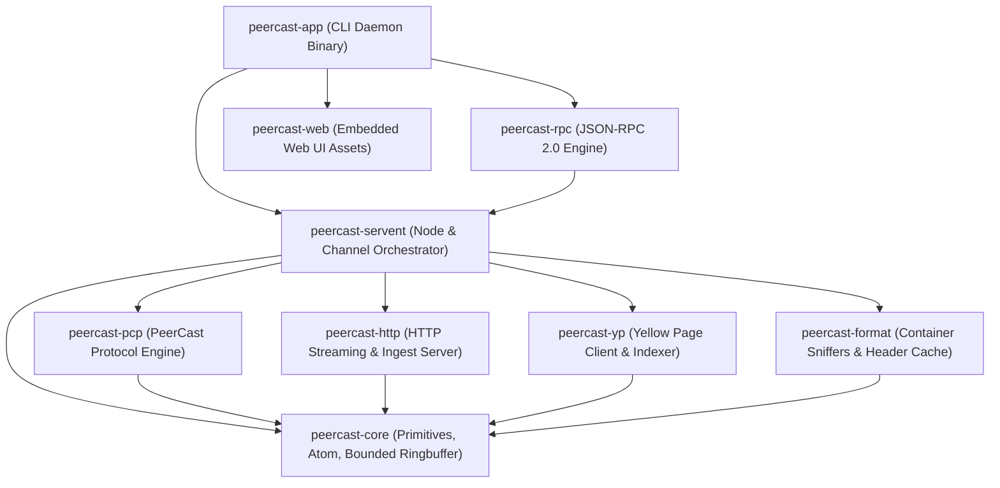
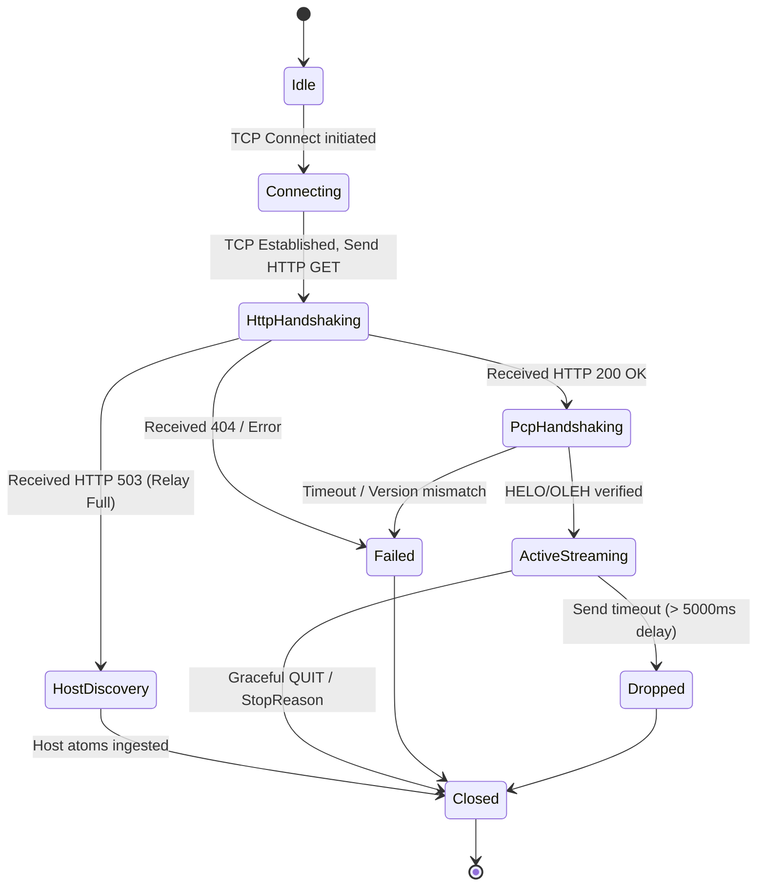

# PeerCastStation Rust Port: Architectural & Technical Specification

> **Document Version**: 1.1.0 (Refined after Upstream Deep-Dive Review)  
> **Status**: APPROVED / ACTIVE SPECIFICATION & IMPLEMENTATION BLUEPRINT  
> **Target Upstream Reference**: [kumaryu/peercaststation (GitHub)](https://github.com/kumaryu/peercaststation)  
> **Author**: Antigravity Engineering Agent  
> **Target Ecosystem**: Rust 2021/2024 Edition, Tokio Multi-Threaded Async Runtime  

---

## 1. Executive Summary & Goals

### 1.1 Objective
This document outlines the complete architectural design, wire-level protocol specification, and phased implementation blueprint for porting **PeerCastStation**—the definitive C#/.NET implementation of the PeerCast P2P streaming protocol—to **Rust**.

### 1.2 Core Design Principles
1. **100% Binary & Wire Interoperability**: Flawlessly communicate with existing PeerCast nodes (PeerCast v0.1216+, PeerCastStation C#, PeerCast-IM), Yellow Pages (YP: SP, TP, etc.), and media players (VLC, mpv, MPC-HC, WMP).
2. **Two-Stage Handshake Conformance**: Strictly replicate the authentic PeerCast connection bootstrap: HTTP-based capability negotiation followed immediately by binary Atom exchanges.
3. **Zero-Copy Fan-Out & Memory Safety**: Leverage Rust's ownership model and `bytes::Bytes` to distribute media chunks to hundreds of downstream relays/listeners with zero buffer copying ($O(1)$ fan-out).
4. **Deterministic Resource Bounds (Longevity by Design)**: Enforce strict bounded queues, ring buffers, and node caches. Eliminate unbounded growth, memory leaks, and socket descriptor exhaustion for continuous 24/7/365 uptime (adhering to Rule #3).
5. **Strict State Machine Formalization**: All asynchronous connections, channel lifecycles, and relay handshakes are modeled with explicit Rust `enum` state machines with re-entrancy protection (Rule #2).
6. **Single Portable Native Binary**: Headless daemon with embedded Web UI assets (`rust-embed`) and JSON-RPC 2.0 API.

---

## 2. Upstream C# Codebase Analysis & Crate Decomposition

Based on deep source inspection of `kumaryu/peercaststation`, the upstream codebase is cleanly factored into functional areas mapped directly to Rust workspace crates:

| Upstream C# Project & Key Files | Primary Responsibilities | Target Rust Crate |
| :--- | :--- | :--- |
| `PeerCastStation.Core`<br>(`Atom.cs`, `Ringbuffer.cs`, `Content.cs`, `Host.cs`, `Channel.cs`, `AccessController.cs`) | Atom FourCC (`ID4`), Atom serialization, bounded `ContentRingBuffer`, node descriptors, channel manager, bandwidth monitoring | `peercast-core` |
| `PeerCastStation.PCP`<br>(`PCPSourceStream.cs`, `PCPOutputStream.cs`, `PCPYellowPageClient.cs`, `PCPVersion.cs`) | HTTP initial handshake (`GET /channel/...`), PCP Atom handshake (`helo`/`oleh`), active ping probe, gossip broadcast (`bcst`), relay flow control | `peercast-pcp` |
| `PeerCastStation.HTTP`<br>(`HTTPOutputStream.cs`, `HTTPSourceStream.cs`, `PlayList.cs`, `HTTPLiveStreamingSegmenter.cs`) | Player HTTP streaming (`/stream/{id}`), playlist generation (`.pls`, `.m3u`, `.asx`), HTTP Push ingest (OBS/ffmpeg), HLS TS chunker | `peercast-http` |
| `PeerCastStation.FLV`, `.TS`, `.ASF`, `.MKV`<br>(`FLVContentBuffer.cs`, `TSContentReader.cs`, `FLVFileParser.cs`) | Media container inspection, codec initialization header caching (FLV sequence header, TS PAT/PMT, ASF header objects) | `peercast-format` |
| `PeerCastStation.PCP` + `PeerCastStation.UI.HTTP`<br>(`PCPYellowPageClient.cs`, `YPChannelsHost.cs`) | Yellow Page directory integration: HTTP `index.txt` parser/query, PCP YP announcements (`PCP_ROOT`), heartbeats | `peercast-yp` |
| `PeerCastStation.Core` + `PeerCastStation.App`<br>(`PeerCast.cs`, `PortMapperPlugin.cs`, `ChannelCleaner.cs`) | Servent orchestration, relay channel vs broadcast channel, UPnP / NAT-PMP port mapping, channel auto-cleaner | `peercast-servent` |
| `PeerCastStation.UI.HTTP`<br>(`APIHost.cs`, `JSONRPC.cs`, `html/` static assets) | JSON-RPC 2.0 API, embedded web administration interface | `peercast-rpc` + `peercast-web` |
| `PecaStationd` / `PeerCastStation.App` | CLI entry point, configuration file persistence (`settings.json`), graceful shutdown | `peercast-app` (binary) |

---

## 3. Rust Workspace Architecture



---

## 4. Deep-Dive Wire Protocol Specifications

### 4.1 Two-Stage PCP Connection Handshake

A critical finding from `PCPSourceStream.cs` and `PCPOutputStream.cs` is that PeerCast relay connections do NOT begin with raw Atoms. They utilize a **two-stage handshake**:

#### Stage 1: HTTP Relay Request & Response
The downstream client connects via TCP to the upstream node and sends an HTTP/1.0 request:
```http
GET /channel/{ChannelID_Hex32} HTTP/1.0\r\n
Host: {RemoteHost}:{RemotePort}\r\n
User-Agent: PeerCastStation-Rust/1.0.0\r\n
x-peercast-pcp: 1\r\n
x-peercast-pos: {CurrentStreamPosition}\r\n
\r\n
```

**Upstream Response Codes**:
- `HTTP/1.0 200 OK`: Upstream accepts the relay connection. The socket immediately switches to binary PCP Atom transmission.
- `HTTP/1.0 503 Service Unavailable`: Upstream relay slots are full (`RelayFull`). Upstream sends a list of alternative candidate nodes (`PCP_HOST` atoms) and closes the socket.
- `HTTP/1.0 404 Not Found`: Channel is off-air. Client terminates connection attempts.

#### Stage 2: Binary Atom Handshake & Active Ping Probe
Once `200 OK` (or `503`) is received, the stream transitions seamlessly to binary Atoms:
1. Downstream sends `helo` (containing `agnt`, `sid`, `port` or `ping`, `ver`).
2. Upstream responds with `oleh` (containing `rip` [downstream's observed global IP], `agnt`, `sid`, `ver`).
3. **Active Port Probe (Ping Probe)**:
   - If downstream provided `ping` (indicating an unknown port status), upstream opens a secondary TCP connection back to downstream's IP on the advertised ping port.
   - Upstream sends `pcnt` (PCP_CONNECT) followed by `helo`. Downstream responds with `oleh`.
   - If `SessionID` matches, upstream confirms downstream's port is reachable (`Firewalled = false`), allowing downstream to serve as an active relay.
4. Normal streaming begins: upstream transmits `head` (codec header), followed by continuous `data` (media chunks) and periodic `bcst` / `host` gossip.

### 4.2 Atom Binary Wire Format

```text
 0                   1                   2                   3
 0 1 2 3 4 5 6 7 8 9 0 1 2 3 4 5 6 7 8 9 0 1 2 3 4 5 6 7 8 9 0 1
+-+-+-+-+-+-+-+-+-+-+-+-+-+-+-+-+-+-+-+-+-+-+-+-+-+-+-+-+-+-+-+-+
|                       Name (4 ASCII Bytes)                    |
+-+-+-+-+-+-+-+-+-+-+-+-+-+-+-+-+-+-+-+-+-+-+-+-+-+-+-+-+-+-+-+-+
|C|                       Length or Child Count                 |
+-+-+-+-+-+-+-+-+-+-+-+-+-+-+-+-+-+-+-+-+-+-+-+-+-+-+-+-+-+-+-+-+
|                       Value Bytes (if C == 0)                 |
|                       or Child Atoms (if C == 1)              |
+-+-+-+-+-+-+-+-+-+-+-+-+-+-+-+-+-+-+-+-+-+-+-+-+-+-+-+-+-+-+-+-+
```

- **Bit 31 (MSB, `0x8000_0000`) = 0**: Leaf Atom. Lower 31 bits = payload byte length.
- **Bit 31 (MSB, `0x8000_0000`) = 1**: Container Atom. Lower 31 bits = count of direct child atoms.
- **Resource Limits (Rule #3)**:
  - Max child count: `1024` child atoms per container.
  - Max leaf length: `16 MB` per Atom.

### 4.3 Full Atom Dictionary

```rust
// Core FourCC Tag Identifiers
pub const PCP_HELO: ID4 = ID4(*b"helo");
pub const PCP_OLEH: ID4 = ID4(*b"oleh");
pub const PCP_OK:   ID4 = ID4(*b"ok  ");
pub const PCP_QUIT: ID4 = ID4(*b"quit");
pub const PCP_CHAN: ID4 = ID4(*b"chan");
pub const PCP_BCST: ID4 = ID4(*b"bcst");
pub const PCP_HOST: ID4 = ID4(*b"host");
pub const PCP_ROOT: ID4 = ID4(*b"root");
pub const PCP_CONNECT: ID4 = ID4(*b"pcnt");

// Channel & Packet Sub-Atoms
pub const PCP_CHAN_ID:   ID4 = ID4(*b"id  "); // 16-byte Channel GUID
pub const PCP_CHAN_BCID: ID4 = ID4(*b"bcid"); // 16-byte Broadcast GUID
pub const PCP_CHAN_PKT:  ID4 = ID4(*b"pkt "); // Packet container
pub const PCP_CHAN_POS:  ID4 = ID4(*b"pos "); // Stream byte position
pub const PCP_CHAN_DATA: ID4 = ID4(*b"data"); // Raw media chunk
pub const PCP_CHAN_HEAD: ID4 = ID4(*b"head"); // Codec init header
pub const PCP_CHAN_CONT: ID4 = ID4(*b"cont"); // Continuation bitmask
pub const PCP_CHAN_INFO: ID4 = ID4(*b"info"); // Channel metadata container
```

---

## 5. Media Pipeline & Header Caching

### 5.1 The Late-Joiner Header Problem
In live streaming, clients connecting mid-stream cannot decode H.264/AAC or MPEG-TS without stream headers (SPS/PPS, audio config, PAT/PMT).
Upstream solves this via `FLVContentBuffer` and `TSContentReader`.

### 5.2 Rust Media Header Cache Architecture (`peercast-format`)
1. **Container Sniffing**: Inspects the first 16 bytes of the stream to identify format:
   - `46 4C 56 01` -> FLV v1
   - `47` every 188 bytes -> MPEG-TS
   - `30 26 B2 75` -> ASF/WMV GUID
   - `1A 45 DF A3` -> Matroska/WebM
   - `4F 67 67 53` -> OGG
2. **Codec Configuration Caching**:
   - For **FLV**: Extracts AMF0 `onMetaData`, AVC Sequence Header (SPS/PPS), and AAC AudioSpecificConfig. Synthesizes a consolidated `ContentHeader`.
   - For **MPEG-TS**: Extracts and continuously updates PAT (PID 0) and PMT tables.
   - For **ASF**: Captures the complete Header Object.
3. **Immediate Replay**: When a new downstream relay or player connects, `peercast-servent` immediately transmits the cached `ContentHeader` before any live `ContentBody` chunks.

---

## 6. HTTP Streaming & Player Interoperability

### 6.1 Endpoints
- `/stream/{channel_id}`: Continuous HTTP chunked media stream (`Transfer-Encoding: chunked`).
- `/pls/{channel_id}`: PLS playlist file.
- `/pls/{channel_id}.m3u` / `/stream/{channel_id}.m3u`: M3U playlist file.
- `/pls/{channel_id}.asx`: ASX playlist file (for WMP).
- `/hls/{channel_id}/playlist.m3u8`: HLS playlist for mobile browsers.

### 6.2 Auto-Relay on Demand (`RequestChannel`)
When a local player requests `/stream/{channel_id}` or `/pls/{channel_id}`:
1. If the channel is already active, stream output begins immediately.
2. If inactive, `peercast-servent` automatically initiates tracker lookup via Yellow Pages (or `tip` URL query parameter) and starts relaying in the background.
3. The HTTP handler awaits `channel.wait_for_ready_header(timeout = 10s)`. Once the header is primed, streaming starts with zero user intervention.

---

## 7. State Machines & Longevity Enforcements

### 7.1 Connection Lifecycle State Machine



### 7.2 Strict Bounded Resource Policy (Rule #3)
1. **Sliding Window `ContentRingBuffer`**:
   - Fixed capacity (e.g., 8 MB max or 3 seconds of buffer).
   - Oldest packets evicted automatically upon arrival of newer packets.
2. **Slow Client Disconnect (Backpressure Guard)**:
   - Upstream uses a 5000 ms queue threshold (`(msg.Timestamp - nxtMsg.Timestamp).TotalMilliseconds <= 5000`).
   - In Rust, if an output queue reaches 5000 ms lag, a `ChannelMessage::Overflow` event triggers, and the client is dropped (`StopReason::SendTimeoutError`) to preserve memory stability.
3. **Socket Descriptor Limits**: Global limits on maximum simultaneous relays (`max_relays`, default 32) and direct listeners (`max_directs`, default 16).

---

## 8. Implementation Roadmap (Phases 1-6)

| Phase | Milestone | Scope & Deliverables |
| :---: | :--- | :--- |
| **Phase 1** | **Core Primitives & Wire Codec** | `peercast-core`: `ID4`, `Atom`, `Content`, `ContentRingBuffer`, serializer/deserializer with round-trip unit tests. |
| **Phase 2** | **PCP Two-Stage Handshake & Codec** | `peercast-pcp`: HTTP handshake parser, Tokio Framed Atom codec, Ping probe engine, `PCPSourceStream`, `PCPOutputStream`. |
| **Phase 3** | **Container Sniffing & HTTP Player Output** | `peercast-format` + `peercast-http`: FLV/TS header caching, HTTP `/stream/{id}`, playlist generation (`.pls`, `.m3u`, `.asx`). |
| **Phase 4** | **P2P Relay & Channel Orchestration** | `peercast-servent`: `ChannelManager`, `RelayChannel`, gossip tree propagation, node keep-alive, bump handling. |
| **Phase 5** | **Yellow Page Integration & Broadcast Ingest** | `peercast-yp`: `index.txt` parser, PCP YP announcement. `BroadcastChannel`: HTTP Push ingest (OBS/ffmpeg). |
| **Phase 6** | **Management Server & Web UI** | `peercast-rpc` (JSON-RPC 2.0 compatible), `peercast-web` (embedded HTML/JS UI via `rust-embed`), CLI daemon binary. |
