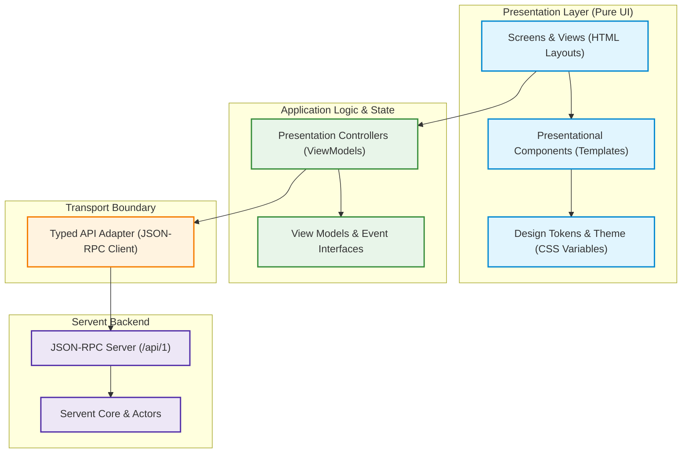

# PeerCastStation Frontend Architecture & UI Layer Boundaries

## 1. Executive Summary & Technology Baseline

- **Prerequisites Satisfied**: Task P37 (JSON-RPC 2.0 Contract Freeze).
- **Requirements Covered**: REQ-080, REQ-085 (Design/Logic separation and incremental migration).
- **Core Directive**: Preserves existing UI behavior and framework choice without proposing a premature wholesale rewrite.
- **Upstream Technology Stack**:
  - **Reactive MVVM Framework**: Knockout.js 3.5.1 (declarative `data-bind` templates and observable state).
  - **CSS & UI Framework**: Bootstrap 5.3.3 with Bootswatch *Cerulean* theme and Bootstrap Icons 1.11.3.
  - **DOM & Utility Libraries**: jQuery 3.7.1 and Popper.js 2.11.8.
  - **Backend Transport**: Dynamic `/api/1/peercaststation.js` proxy calling `POST /api/1`.

---

## 2. Layer Hierarchy & Dependency Direction

The frontend architecture adheres strictly to inward-pointing dependencies (REQ-080).
Higher layers depend exclusively on abstractions defined by lower layers; backend relay logic has zero knowledge of frontend presentation details.



### Layer Responsibilities

1. **Design Tokens (`design/tokens.css`)**:
   - Semantic color, spacing, typography, elevation, and border tokens.
   - Defines CSS custom properties (`--peca-bg-surface`, `--peca-color-text`, `--peca-color-primary`, `--peca-radius-card`, etc.).
   - Pure CSS; NO network logic, DOM dependencies, or JavaScript code.

2. **Presentational Components (`components/`)**:
   - Reusable HTML template widgets (Toast alert, EndPoint badge, Bitrate pill, Stream status indicator, Connection row).
   - Render strictly from props/observable values passed into the template.
   - Emits semantic events (e.g. `onSelect`, `onDelete`) to parent controllers; NEVER issues direct network calls.

3. **Screens & Views (`screens/` or `html/*.html`)**:
   - Composes layout grids, navigation bars, headers, and component containers.
   - Binds HTML elements to controllers via Knockout `data-bind`.
   - Contains NO inline network calls or raw JSON-RPC invocations.

4. **Controllers / ViewModels (`controllers/` or `js/*.js`)**:
   - Owns reactive screen state: `idle`, `loading`, `error`, `empty`, `pendingMutation`.
   - Normalizes data from the API Adapter into display view models.
   - Handles user interactions (button clicks, form submits) and dispatches commands through the API Adapter.
   - Testable in isolation without a browser DOM or running backend.

5. **Typed API Adapter (`api/rpc_client.js`)**:
   - Single point of egress for HTTP JSON-RPC 2.0 communication.
   - Injects required headers (`X-Requested-With`, `Content-Type: application/json`).
   - Handles authentication tokens (Basic Auth / query parameter / cookie).
   - Enforces request ID incrementing, timeouts (5,000ms), and cancellation.
   - Normalizes JSON-RPC errors into typed application exceptions.

---

## 3. Allowed and Forbidden Dependency Edges (REQ-080)

| From Layer | To Layer | Status | Rule / Rationale |
|---|---|---|---|
| Screen / View | Controller | **ALLOWED** | Views bind observable state and dispatch semantic events. |
| Screen / View | Components | **ALLOWED** | Screens compose presentational component templates. |
| Component | Tokens | **ALLOWED** | Components style themselves using theme tokens. |
| Controller | API Adapter | **ALLOWED** | Controllers invoke typed API adapter methods for data/mutations. |
| Controller | Tokens / CSS | **FORBIDDEN** | Controllers must not infer domain state from CSS classes or colors. |
| View / Component | API Adapter | **FORBIDDEN** | UI elements must never bypass the controller to call backend directly. |
| View / Component | Raw `fetch` / `$.ajax` | **FORBIDDEN** | All network calls must pass through the API Adapter. |
| API Adapter | DOM / UI Elements | **FORBIDDEN** | Adapter is a pure transport layer independent of DOM. |
| Backend | Frontend UI Files | **FORBIDDEN** | Backend serves static assets but contains no UI styling dependencies. |

---

## 4. Complete API Call-to-Adapter Mapping (REQ-085)

Every one of the 45 audited JSON-RPC methods is assigned an authoritative owning controller and adapter method:

| JSON-RPC Method | Access | Owning Controller | Adapter Method | Category |
|---|---|---|---|---|
| `getVersionInfo` | Play/Admin | `IndexController`, `UpdateController` | `api.getVersionInfo()` | Core Supported |
| `getStatus` | Play/Admin | `IndexController`, `PlayController`, `RelaysController` | `api.getStatus()` | Core Supported |
| `getChannels` | Play/Admin | `ChannelsController`, `PlayController`, `RelaysController` | `api.getChannels()` | Core Supported |
| `getSettings` | Admin | `SettingsController` | `api.getSettings()` | Core Supported |
| `setSettings` | Admin | `SettingsController` | `api.setSettings(settings)` | Core Supported |
| `getAuthToken` | Play/Admin | `ChannelsController`, `PlayController`, `RelaysController` | `api.getAuthToken()` | Core Supported |
| `getPlugins` | Admin | `IndexController` | `api.getPlugins()` | Core Supported |
| `getExternalIPAddresses` | Admin | `SettingsController` | `api.getExternalIPAddresses()` | Deferred |
| `getLogSettings` | Admin | `LogsController` | `api.getLogSettings()` | Deferred |
| `setLogSettings` | Admin | `LogsController` | `api.setLogSettings(settings)` | Deferred |
| `getLog` | Admin | `LogsController` | `api.getLog(level, limit)` | Deferred |
| `clearLog` | Admin | `LogsController` | `api.clearLog()` | Deferred |
| `getChannelStatus` | Play/Admin | `ChannelsController` | `api.getChannelStatus(id)` | Deferred |
| `getChannelInfo` | Play/Admin | `ChannelsController` | `api.getChannelInfo(id)` | Deferred |
| `setChannelInfo` | Admin | `RelaysController` | `api.setChannelInfo(id, info)` | Deferred |
| `stopChannel` | Admin | `RelaysController` | `api.stopChannel(id)` | Deferred |
| `bumpChannel` | Admin | `RelaysController` | `api.bumpChannel(id)` | Deferred |
| `getChannelOutputs` | Admin | `RelaysController` | `api.getChannelOutputs(id)` | Deferred |
| `stopChannelOutput` | Admin | `RelaysController` | `api.stopChannelOutput(id, outId)` | Deferred |
| `getChannelConnections` | Admin | `RelaysController` | `api.getChannelConnections(id)` | Deferred |
| `stopChannelConnection` | Admin | `RelaysController` | `api.stopChannelConnection(id, connId)` | Deferred |
| `restartChannelConnection` | Admin | `RelaysController` | `api.restartChannelConnection(id, connId)` | Deferred |
| `getChannelRelayTree` | Admin | `RelaysController` | `api.getChannelRelayTree(id)` | Deferred |
| `getContentReaders` | Admin | `RelaysController` | `api.getContentReaders()` | Deferred |
| `getSourceStreams` | Admin | `RelaysController` | `api.getSourceStreams()` | Deferred |
| `getYellowPageProtocols` | Admin | `SettingsController` | `api.getYellowPageProtocols()` | Deferred |
| `getYellowPages` | Admin | `RelaysController`, `SettingsController` | `api.getYellowPages()` | Deferred |
| `addYellowPage` | Admin | `SettingsController` | `api.addYellowPage(yp)` | Deferred |
| `removeYellowPage` | Admin | `SettingsController` | `api.removeYellowPage(id)` | Deferred |
| `stopAnnounce` | Admin | `RelaysController` | `api.stopAnnounce(id)` | Deferred |
| `restartAnnounce` | Admin | `RelaysController` | `api.restartAnnounce(id)` | Deferred |
| `getListeners` | Admin | `RelaysController`, `SettingsController` | `api.getListeners()` | Deferred |
| `addListener` | Admin | `SettingsController` | `api.addListener(listener)` | Deferred |
| `resetListenerAuthenticationKey` | Admin | `SettingsController` | `api.resetListenerAuthenticationKey(id)` | Deferred |
| `removeListener` | Admin | `SettingsController` | `api.removeListener(id)` | Deferred |
| `setListenerAccepts` | Admin | `SettingsController` | `api.setListenerAccepts(id, accepts)` | Deferred |
| `setListenerAuthorizationRequired` | Admin | `SettingsController` | `api.setListenerAuthorizationRequired(id, req)` | Deferred |
| `broadcastChannel` | Admin | `RelaysController` | `api.broadcastChannel(info)` | Deferred |
| `getBroadcastHistory` | Admin | `RelaysController` | `api.getBroadcastHistory()` | Deferred |
| `addBroadcastHistory` | Admin | `RelaysController` | `api.addBroadcastHistory(entry)` | Deferred |
| `getNotificationMessages` | Admin | `UIViewModel` (Global Alerts) | `api.getNotificationMessages()` | Deferred |
| `checkBandwidth` | Admin | `SettingsController` | `api.checkBandwidth()` | Deferred |
| `checkPorts` | Admin | `SettingsController` | `api.checkPorts()` | Deferred |
| `checkUpdate` | Admin | `UpdateController` | `api.checkUpdate()` | Deferred |
| `updateAndRestart` | Admin | `UpdateController` | `api.updateAndRestart()` | Deferred |
| `getUpdateStatus` | Admin | `UpdateController` | `api.getUpdateStatus()` | Deferred |
| `getNewVersions` | Admin | `UIViewModel`, `UpdateController` | `api.getNewVersions()` | Deferred |
| `updateYPChannels` | Admin | `ChannelsController` | `api.updateYPChannels()` | Deferred |
| `setUserConfig` | Admin | `UIViewModel` (Theme/Preferences) | `api.setUserConfig(user, key, val)` | Deferred |
| `getUserConfig` | Admin | `UIViewModel` (Theme/Preferences) | `api.getUserConfig(user, key)` | Deferred |

---

## 5. Incremental Screen Migration Plan (REQ-085)

Migration proceeds screen-by-screen, maintaining backwards compatibility at every step:

```
[Phase P37B] Implement Centralized Typed API Adapter (api/rpc_client.js)
     │
     ▼
[Phase P37C] First Screen Migration: Index Screen (index.html + IndexController)
     │       - Extract IndexViewModel logic into controller with loading/error states
     │       - Test with Mock API adapter (no daemon required)
     │
     ▼
[Phase P37D] Design Tokens & Pure Presentational Components (tokens.css + alert.html)
     │       - Extract themeable CSS variables
     │       - Verify responsive layout & high-contrast themes
     │
     ▼
Subsequent Screen Migrations:
     1. Channels View (channels.html)
     2. Play View (play.html)
     3. Settings View (settings.html)
     4. Relays View (relays.html)
     5. Logs & Update Views (logs.html, update.html)
```
